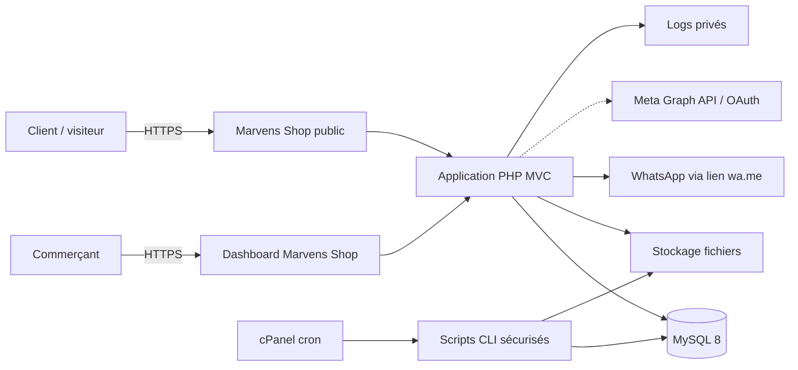
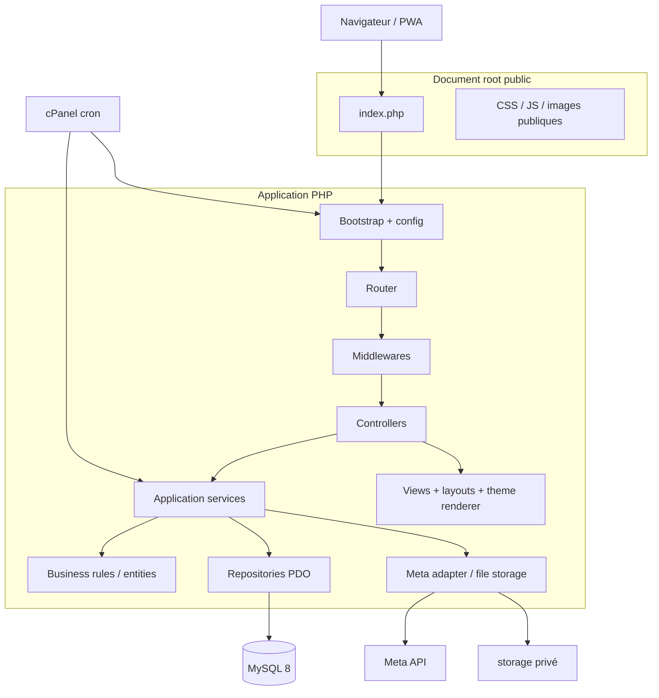
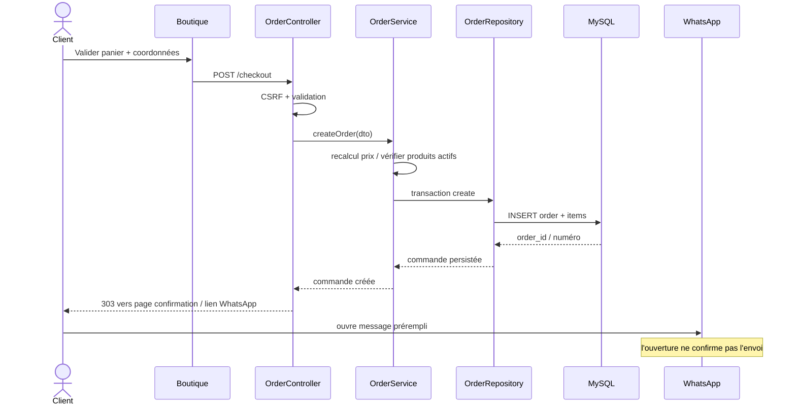
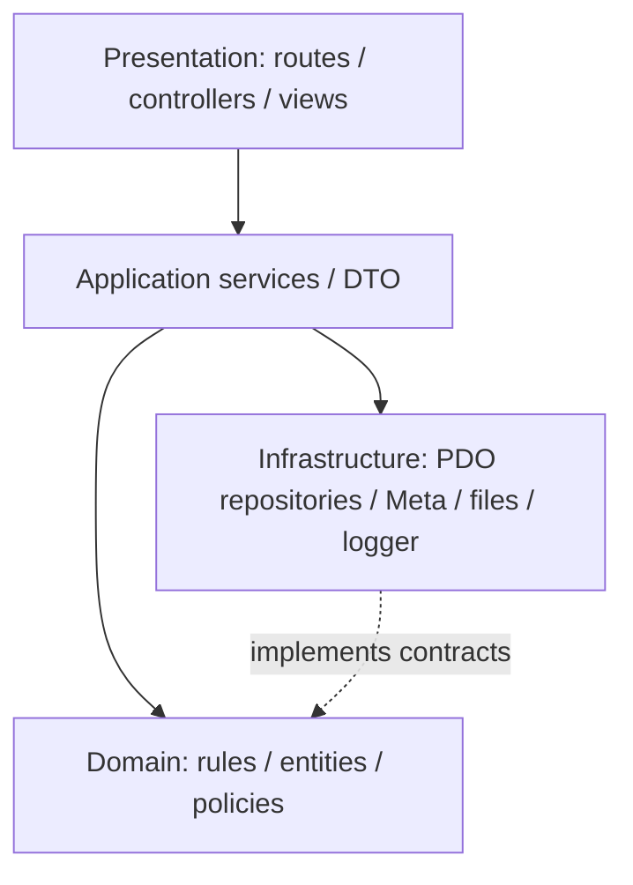
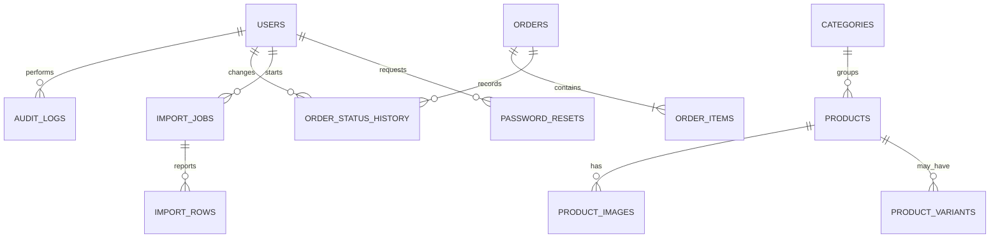

# ARCHITECTURE_TECHNIQUE_PROJET.md
## Marvens Shop — Architecture fonctionnelle et technique du MVP

**Version :** 1.0  
**Date :** 05 novembre 2026  
**Statut :** architecture de référence à valider avant développement  
**Socle :** PHP 8.3 Vanilla MVC, MySQL 8, PDO, HTML5/CSS3, JavaScript Vanilla, Bootstrap 5, cPanel mutualisé

> **Convention de statut**
> - **Confirmé** : établi par les documents du projet ou une contrainte explicite.
> - **Recommandation** : proposition technique pour rendre le développement vérifiable.
> - **À valider** : décision qui ne peut pas être déduite des sources.
>
> Ce document définit l’architecture, pas le code métier complet ni les migrations SQL finales.

---

# 1. Résumé architectural

Marvens Shop MVP est une boutique web légère destinée aux commerçants, avec mini-site public, catalogue, panier, création de commande persistée, ouverture d’une conversation WhatsApp préremplie et tableau de bord de suivi.

**Modèle MVP confirmé :** une installation indépendante par commerçant, sur son domaine ou sous-domaine. Marvens installe et configure le script. Le MVP n’est pas un SaaS : pas d’inscription autonome, de provisioning multi-tenant, de base partagée ni de facturation SaaS. Une architecture SaaS ultérieure pourra être étudiée après validation du MVP, mais ne doit pas être anticipée par une complexité multi-tenant dans cette version.

**Flux métier central :** catalogue → panier → validation serveur → commande enregistrée → redirection/ouverture WhatsApp → suivi par le commerçant. L’ouverture de WhatsApp ne prouve ni l’envoi du message, ni la confirmation, ni le paiement.

**Paiement :** aucune passerelle de paiement intégrée au MVP. Le paiement à la livraison est proposé dans les documents comme mode privilégié ; les modes réellement activés sont configurables et **À valider**. Le statut de paiement est distinct du statut de commande.

**Design :** le ZIP `MARVENS_CREATIVE_BRIEF_MARVENS_SHOP_20261104_151943.zip` constitue le cadre de direction artistique, UX/UI, design system, accessibilité, performance et standards techniques. Les templates Stitch du dossier `themes/` doivent être les choix de thème du commerçant. Le dossier `themes/` n’a pas été détecté dans l’espace de travail analysé : inventaire, intégrité et compatibilité des thèmes restent **À valider** avant intégration. Aucun thème ni style ne doit être inventé comme étant déjà fourni.

## 1.1 Décisions structurantes

| Sujet | Décision / statut |
|---|---|
| Technologie | PHP 8.3 Vanilla MVC, MySQL 8, PDO, Bootstrap 5, JS Vanilla — confirmé/imposé |
| Hébergement | cPanel mutualisé, déploiement fichiers + SQL, cron cPanel uniquement — confirmé/imposé |
| Architecture | MVC modulaire simple, séparation contrôleurs/services/repositories — recommandation |
| Installation | une installation par commerçant — confirmé |
| Multi-tenant SaaS | hors MVP ; ne pas ajouter tenant_id partout sans besoin — confirmé |
| PWA | compatibilité PWA à mettre en œuvre uniquement dans la mesure prévue par le cahier des charges ; stratégie détaillée à valider |
| Paiement | pas de passerelle dans le MVP ; suivi manuel — confirmé |
| WhatsApp | lien/message prérempli ; statut d’envoi non inféré — confirmé |
| Import Meta | OAuth et permissions officielles, sous réserve de faisabilité et accès Meta — prévu, dépendance externe |
| Thèmes Stitch | thèmes présents dans `themes/` à inventorier ; sélection et aperçu — prévu |
| Inscription e-mail/clients | compte commerçant installé/configuré par Marvens ; besoin d’inscription publique non confirmé |
| API REST | uniquement endpoints requis par interactions asynchrones/import ; éviter API publique inutile |

---

# 2. Sources et contraintes

## 2.1 Sources du projet

1. `Marvens_Shop_Document_Complet_MVP.docx` — cadrage fonctionnel et modèle d’installation.
2. `FONCTIONNALITÉS.docx` — fonctionnalités, paramètres et comportement e-commerce.
3. `Paramètres.docx` — réglages du dashboard.
4. `MARVENS_CREATIVE_BRIEF_MARVENS_SHOP_20261104_151943.zip` — framework de conception et standards :
   - `PROJECT_CONTEXT.md`, `README_PROJECT.md`, `GENERATION_MANIFEST.md`
   - templates de brief, blueprint UX/UI et validation design
   - directions artistiques : Swiss Editorial Commerce, Luxury Editorial, Afro Contemporary, Organic Modern, Neo Brutalism
   - standards PHP MVC, frontend, Bootstrap, sécurité, performance et accessibilité
5. Contraintes explicitement données dans la demande et le contexte du projet : PHP Vanilla MVC, MySQL 8, PDO, cPanel, aucun Node.js de production, aucun Docker, aucun processus permanent.

## 2.2 Hiérarchie en cas de contradiction

Appliquer l’ordre fourni par le porteur : décisions validées → cahier des charges → règles métier/parcours → design → idée initiale → recommandations. Toute contradiction non résolue est listée en section 28, « Décisions techniques à valider ».

## 2.3 Confirmé vs recommandé

| Élément | Statut |
|---|---|
| Boutique, catalogue, panier, commandes, WhatsApp, dashboard | Confirmé |
| Installation dédiée par commerçant pour MVP | Confirmé |
| Catalogue Meta et import CSV/Excel | Fonctionnalité prévue ; disponibilité Meta à vérifier |
| Thèmes Stitch | Confirmé comme direction ; fichiers `themes/` non détectés |
| PWA installable et offline complet | À valider selon périmètre fonctionnel et exigences métier |
| Notifications e-mail/SMS/push | À valider ; ne pas activer sans décision |
| Multi-tenant, marketplace, SaaS billing | Hors MVP |
| Paiement en ligne | Hors MVP |
| Gestion avancée de stock, coupons, fidélité, livraison intégrée | Non confirmée ; ne pas inclure par défaut |

---

# 3. Principes d’architecture

1. **Responsabilités séparées :** HTTP dans contrôleurs, orchestration dans services applicatifs, règles métier dans services/domaines, SQL dans repositories.
2. **MVC explicite sans framework :** composants PHP simples, autoload léger (Composer facultatif si disponible, sans framework) ou autoload interne.
3. **Couplage réduit :** services dépendant de contrats repository/adapters, pas des détails SQL ou HTTP.
4. **Sécurité côté serveur :** validation, authentification et permissions à chaque action protégée.
5. **Installation single-merchant :** le commerçant courant est la configuration de l’installation, pas un tenant sélectionnable dans chaque requête.
6. **Données et thème séparés :** thème sélectionné par identifiant validé ; aucun template ne peut exécuter du PHP arbitraire.
7. **Compatibilité cPanel :** requêtes HTTP classiques et scripts CLI cron ; pas de workers persistants.
8. **Simplicité MVP :** pas de CQRS, microservices, event bus ou cache distribué sans besoin réel.
9. **Audit des actions sensibles :** connexion, changement de paramètres, modification de commande, import et gestion d’accès.
10. **Progressivité :** composants extensibles sans construire le SaaS futur prématurément.

---

# 4. Vue générale du système

## 4.1 Contexte



## 4.2 Composants



## 4.3 Flux de création de commande



---

# 5. Architecture MVC modulaire

## 5.1 Responsabilités

| Élément | Responsabilité | Interdit |
|---|---|---|
| `public/index.php` | point d’entrée HTTP, charge bootstrap et dispatch | logique métier, secrets |
| Bootstrap | charge config, autoload, erreurs, session, dépendances | SQL métier |
| Router | associe méthode + URI à une route | vérifier seul les permissions métier |
| Middleware | session, CSRF, auth, rate limit, headers | règles métier complexes |
| Controller | lire requête, valider DTO, appeler service, choisir réponse | SQL direct, calcul prix autoritaire |
| Application service | orchestration d’un cas d’usage | rendu HTML |
| Domain/service métier | règles de commande, statut, prix, disponibilité | dépendance HTTP/PDO |
| Entity/Model | état et invariants métier utiles | requêtes SQL directes |
| Repository | requêtes PDO, mapping | HTML, session, redirects |
| Validator | validation structurée et messages | autorisation |
| Policy | contrôle de l’action et de la ressource | seulement masquer les boutons |
| View/layout | HTML échappé, composition de page | accès DB, secrets |
| Frontend JS | UX, fetch, validation préliminaire | décision d’autorisation |
| File service | validation, stockage, suppression contrôlée | chemin fourni directement par client |
| Error handler | réponse neutre, correlation ID, log | afficher stack trace en production |
| Cron CLI | tâches bornées et idempotentes | exposer endpoint web sans secret |
| Config | valeurs environnement, secrets hors dépôt | versionner secrets |
| Tests | vérifier règles, routes, permissions et intégrations | dépendre de données production |

## 5.2 Règle de dépendance



- Les vues ne connaissent ni PDO ni repositories.
- Les contrôleurs ne contiennent pas de règles tarifaires ou de transition de statut.
- Le domaine ne dépend pas de `$_POST`, `$_SESSION`, HTTP ou PDO.
- Les repositories n’exposent que des méthodes nécessaires et tenant-independent pour cette installation.
- Toute donnée utilisateur est traitée comme non fiable.
- Les dépendances sont injectées explicitement via un `Container` minimal ou un bootstrap de composition ; pas de service locator global dispersé.

## 5.3 Middlewares recommandés

- `SecurityHeadersMiddleware`
- `CorrelationIdMiddleware`
- `SessionMiddleware`
- `AuthMiddleware`
- `PermissionMiddleware`
- `CsrfMiddleware` pour méthodes mutantes web
- `RateLimitMiddleware` sur login, checkout et import
- `ContentNegotiationMiddleware` pour HTML/JSON

---

# 6. Découpage des modules

## 6.1 Modules MVP

| Module | Objectif / acteurs | Contrôleurs et services | Entités / tables principales | Routes | Permissions / dépendances | Logs et tests |
|---|---|---|---|---|---|---|
| Public storefront | Visiteur consulte boutique | `StorefrontController`, `CatalogQueryService` | `settings`, `categories`, `products`, `product_images` | GET `/`, `/catalog`, `/products/{slug}`, `/categories/{slug}` | public ; catalog | tests publication, pagination, XSS |
| Catalogue | Commerçant gère produits/catégories | `ProductController`, `ProductService`, `CategoryService` | `products`, `categories`, `product_images`, `product_variants` (si validées) | `/admin/products`, `/admin/categories` | `catalog.read/write` ; file service | audit CRUD, upload, validation |
| Panier / checkout | Client compose et soumet commande | `CartController`, `CheckoutController`, `CartService`, `OrderService` | `orders`, `order_items` | GET `/cart`, POST `/checkout` | public + CSRF + rate limit | double soumission, prix recalculé |
| Commandes | Commerçant suit et traite commandes | `OrderAdminController`, `OrderService`, `OrderStatusService` | `orders`, `order_items`, `order_status_history` | `/admin/orders`, `/admin/orders/{id}`, PATCH statut | `orders.read/write` | transition statut, audit |
| WhatsApp | Préparer message de commande | `WhatsAppMessageBuilder` | champs de commande/config | lien généré dans confirmation | pas de API WhatsApp requise | vérifier encodage, aucune fausse confirmation |
| Import catalogue | CSV/Excel et Meta selon accès | `ImportController`, `CatalogImportService`, `MetaCatalogAdapter` | `import_jobs`, `import_rows`, `products`, `categories` | `/admin/import`, POST import | `catalog.import`; OAuth Meta | idempotence, rapport, erreurs |
| Paramètres boutique | identité, contacts, livraison, thème | `SettingsController`, `SettingsService` | `settings`, `theme_settings` | `/admin/settings/*` | `settings.manage` | audit changements |
| Thèmes | choisir thème Stitch et personnaliser options autorisées | `ThemeController`, `ThemeService` | `themes` ou config, `settings` | `/admin/theme` | `theme.manage`; thème whitelisté | test responsive et XSS |
| Auth admin | accès commerçant et sessions | `AuthController`, `AuthService` | `users`, `password_resets`, `login_attempts` | `/admin/login`, `/admin/logout`, `/admin/password/*` | auth + rate limit | session fixation, bruteforce |
| Dashboard | synthèse commandes/indicateurs | `DashboardController`, `DashboardQueryService` | commandes, produits | `/admin` | `dashboard.read` | chiffres excluent commandes non finalisées |
| Audit / système | traçabilité et santé | `AuditLogger`, `HealthController` | `audit_logs` | route santé protégée | accès limité | test logs sans secrets |

## 6.2 Modules transversaux

- configuration et installation ;
- authentification/session ;
- permissions ;
- validation ;
- base de données/transactions ;
- stockage fichiers ;
- erreurs/logging/correlation ID ;
- sécurité HTTP/CSRF/rate limit ;
- thème/layout ;
- cron et sauvegarde ;
- tests.

## 6.3 Reportés ou non confirmés

SaaS multi-tenant, paiement en ligne, facturation récurrente, marketplace, SMS/push, stock avancé, fidélité, couponing, transporteur/API livraison, notifications automatiques et inscription libre : **hors MVP ou À valider**. Ne pas créer routes, tables ou providers pour ces fonctions sans décision.

---

# 7. Arborescence du projet

```text
marvens-shop/
├── app/
│   ├── Application/
│   │   ├── Catalog/
│   │   ├── Checkout/
│   │   ├── Orders/
│   │   ├── Imports/
│   │   ├── Settings/
│   │   └── Dashboard/
│   ├── Domain/
│   │   ├── Catalog/
│   │   ├── Orders/
│   │   └── Shared/
│   ├── Infrastructure/
│   │   ├── Database/
│   │   ├── Meta/
│   │   ├── Files/
│   │   ├── Logging/
│   │   └── Mail/
│   ├── Http/
│   │   ├── Controllers/
│   │   ├── Middleware/
│   │   ├── Requests/
│   │   └── Responses/
│   ├── Policies/
│   ├── Validation/
│   ├── Views/
│   │   ├── layouts/
│   │   ├── components/
│   │   ├── storefront/
│   │   └── admin/
│   └── Support/
├── bootstrap/
│   ├── app.php
│   └── dependencies.php
├── config/
│   ├── app.php
│   ├── database.php
│   ├── security.php
│   └── services.php
├── database/
│   ├── migrations/
│   ├── seeds/
│   └── schema/
├── docs/
│   ├── ARCHITECTURE_TECHNIQUE_PROJET.md
│   ├── INSTALLATION_CPANEL.md
│   └── API.md
├── public/
│   ├── index.php
│   ├── .htaccess
│   ├── assets/
│   │   ├── css/
│   │   ├── js/
│   │   └── images/
│   │
│   ├── manifest.webmanifest       # si PWA validée
│   └── service-worker.js          # si PWA validée
├── resources/
│   ├── themes/                    # thèmes Stitch validés, code contrôlé
│   ├── css/
│   ├── js/
│   └── icons/
├── routes/
│   ├── web.php
│   └── api.php
├── storage/
│   ├── private/
│   │   ├── product-originals/
│   │   ├── imports/
│   │   └── exports/
│   ├── logs/
│   ├── sessions/                  # si sessions fichiers retenues
│   ├── cache/
│   └── backups/
├── bin/
│   ├── cron-runner.php
│   └── health-check.php
├── tests/
│   ├── Unit/
│   ├── Integration/
│   ├── Functional/
│   └── Security/
├── .env.example
├── .gitignore
└── README.md
```

### 7.1 Règles d’exposition et permissions

| Chemin | Web accessible ? | Contenu / règle |
|---|---|---|
| `public/` | Oui, seul document root | point d’entrée, assets publics, manifest/SW validés |
| `app/`, `bootstrap/`, `config/`, `database/`, `routes/`, `tests/`, `bin/` | Non | hors document root ; permissions lecture contrôlée |
| `storage/private/` | Non | fichiers originaux, imports, exports privés |
| `storage/logs/`, `storage/backups/`, `storage/sessions/` | Non | interdiction d’accès direct URL |
| `resources/themes/` | normalement non direct | templates rendus par application ; assets compilés/copiés dans public si nécessaire |
| `.env` | Non | hors webroot ; `0600` si possible, jamais versionné |
| `.env.example` | dépôt uniquement | aucun secret réel |

**Si cPanel impose `public_html` comme document root :** placer le code privé au-dessus de `public_html`, et ne mettre dans `public_html` que le contenu de `public/`. Si ce layout est impossible, bloquer explicitement l’accès à chaque dossier privé via `.htaccess` et vérifier par tests HTTP ; cette solution est moins préférable.

---

# 8. Cycle d’une requête

1. Requête HTTPS arrive sur `public/index.php`.
2. Bootstrap charge configuration validée et autoload.
3. Génération d’un correlation ID (ou reprise d’un ID validé).
4. Session sécurisée démarrée uniquement si nécessaire.
5. Router résout méthode + URI.
6. Middlewares exécutés dans ordre documenté.
7. Authentification puis permission de l’action/ressource.
8. DTO construit depuis les entrées et validé.
9. Contrôleur appelle le service applicatif.
10. Service applique règles métier et utilise transaction si mutation.
11. Repository exécute PDO préparé.
12. Contrôleur renvoie vue, JSON, redirect ou téléchargement autorisé.
13. Logger consigne résultat et correlation ID sans secrets.
14. Gestionnaire central traite exception et répond selon environnement.

### Réponses attendues

| Cas | Comportement |
|---|---|
| GET HTML valide | `200` |
| Création HTML | `303 See Other` vers confirmation, après commit |
| API création | `201 Created` et JSON |
| Validation | `422` JSON ou rendu formulaire avec erreurs |
| Non authentifié | `302` login pour web ; `401` API |
| Permission refusée | `403` |
| Ressource absente | `404` |
| Conflit d’état / doublon | `409` |
| CSRF invalide | `403` |
| Rate limit | `429` + `Retry-After` |
| Erreur inattendue | `500` générique avec correlation ID |

---

# 9. Catalogue des routes Web et API

Les routes ci-dessous constituent le minimum architectural dérivé du MVP. Les noms d’actions sont indicatifs et doivent être alignés lors de l’implémentation. Les endpoints JSON ne sont ajoutés que pour les interactions asynchrones.

## 9.1 Routes publiques

| Méthode | URI | Contrôleur/action | Réponse | Paramètres / validation | CSRF / rôle |
|---|---|---|---|---|---|
| GET | `/` | `StorefrontController::home` | HTML | paramètres boutique | public |
| GET | `/catalog` | `CatalogController::index` | HTML | `q`, category, page, sort allowlist | public |
| GET | `/categories/{slug}` | `CatalogController::category` | HTML | slug valide | public |
| GET | `/products/{slug}` | `ProductController::show` | HTML | slug, produit publié | public |
| GET | `/cart` | `CartController::show` | HTML | session panier | public |
| POST | `/cart/items` | `CartController::add` | redirect/JSON | product_id, quantity, variant | CSRF |
| PATCH | `/cart/items/{id}` | `CartController::update` | redirect/JSON | quantité positive, item session | CSRF |
| DELETE | `/cart/items/{id}` | `CartController::remove` | redirect/JSON | item panier | CSRF |
| GET | `/checkout` | `CheckoutController::form` | HTML | panier non vide | public |
| POST | `/checkout` | `CheckoutController::create` | redirect/JSON | nom, téléphone, adresse/zone, mode livraison/paiement activé, note | CSRF + rate limit |
| GET | `/order/confirmation/{token}` | `CheckoutController::confirmation` | HTML | token opaque, commande correspondante | token limité |

## 9.2 Administration

| Méthode | URI | Contrôleur/action | Réponse | Rôle / permission |
|---|---|---|---|---|
| GET/POST | `/admin/login` | `AuthController` | HTML | public + rate limit |
| POST | `/admin/logout` | `AuthController::logout` | redirect | authentifié + CSRF |
| GET | `/admin` | `DashboardController::index` | HTML | `dashboard.read` |
| GET | `/admin/products` | `ProductAdminController::index` | HTML | `catalog.read` |
| GET/POST | `/admin/products/create` | `ProductAdminController::create` | HTML | `catalog.write` |
| GET/POST | `/admin/products/{id}/edit` | `ProductAdminController::edit` | HTML | `catalog.write` |
| POST | `/admin/products/{id}/delete` | `ProductAdminController::delete` | redirect | `catalog.write` + CSRF |
| GET/POST | `/admin/categories` | `CategoryAdminController` | HTML | `catalog.write` |
| GET | `/admin/orders` | `OrderAdminController::index` | HTML | `orders.read` |
| GET | `/admin/orders/{id}` | `OrderAdminController::show` | HTML | `orders.read` |
| PATCH | `/admin/orders/{id}/status` | `OrderAdminController::status` | redirect/JSON | `orders.write`, CSRF, transition validée |
| GET/POST | `/admin/settings` | `SettingsController` | HTML | `settings.manage` |
| GET/POST | `/admin/theme` | `ThemeController` | HTML | `theme.manage` |
| GET/POST | `/admin/import` | `ImportController` | HTML | `catalog.import` |
| POST | `/admin/import/csv` | `ImportController::csv` | JSON/redirect | fichier validé, rate limit |
| GET | `/admin/import/meta/connect` | `MetaController::connect` | redirect | `catalog.import` |
| GET | `/admin/import/meta/callback` | `MetaController::callback` | redirect | state OAuth validé |
| POST | `/admin/import/meta/run` | `MetaController::run` | JSON/redirect | `catalog.import`, CSRF |

## 9.3 API JSON minimale

| Méthode | URI | Usage | Protection |
|---|---|---|---|
| GET | `/api/v1/catalog` | pagination/filtre catalogue si JS en a besoin | public, limites |
| POST | `/api/v1/cart/items` | ajout panier | CSRF session |
| PATCH | `/api/v1/cart/items/{id}` | quantité | CSRF session |
| DELETE | `/api/v1/cart/items/{id}` | retrait | CSRF session |
| POST | `/api/v1/checkout` | checkout AJAX éventuel | CSRF + rate limit |
| GET | `/api/v1/admin/orders` | liste paginée | auth + `orders.read` |
| PATCH | `/api/v1/admin/orders/{id}/status` | changement statut | auth + permission + CSRF |
| GET | `/api/v1/admin/import/{jobId}` | progression import | auth + permission |
| GET | `/health` | santé limitée | IP allowlist ou auth système ; réponse minimale |

### Contrat JSON

- `Content-Type: application/json; charset=utf-8`.
- Succès : `{ "data": ..., "meta": ... }`.
- Erreur : `{ "error": { "code": "VALIDATION_ERROR", "message": "...", "details": ... }, "request_id": "..." }`.
- Ne jamais renvoyer stack trace, SQL, chemins filesystem, secrets ou données personnelles non nécessaires.
- Validation serveur autoritaire ; validation JS uniquement pour UX.
- Rate limit : login, checkout, import, recherche abusive et endpoints sensibles.
- Aucun endpoint DELETE de commande n’est prévu : l’historique doit être conservé ; annulation/archivage est **À valider**.

---

# 10. Architecture de la base de données

## 10.1 Principes

- MySQL 8, InnoDB, `utf8mb4`, timezone applicative documentée.
- Identifiants primaires `BIGINT UNSIGNED AUTO_INCREMENT` recommandés, sauf token public opaque.
- Dates stockées en UTC (`DATETIME`) et affichées en timezone configurée.
- Montants en `DECIMAL(12,2)` ou unité monétaire entière selon décision ; **À valider** si prix FCFA toujours entier.
- PDO préparé, paramètres bindés ; noms de colonnes/table non issus de l’utilisateur.
- Toutes les mutations sensibles en transaction.
- Soft delete seulement si utile à l’audit ; pas de suppression cascade d’une commande vers ses lignes.
- Pas de `tenant_id` dans le MVP single-installation ; isolation par base/configuration dédiée.

## 10.2 Tables principales

| Table | Responsabilité | Colonnes essentielles | Index / contraintes |
|---|---|---|---|
| `users` | compte admin commerçant | id, name, email, password_hash, status, last_login_at, created_at, updated_at | UNIQUE email, index status |
| `password_resets` | jeton de récupération | id, user_id, token_hash, expires_at, used_at, created_at | UNIQUE token_hash, FK users |
| `login_attempts` | limitation login | id, login_key_hash, ip_hash, attempted_at, success | index login_key_hash + attempted_at |
| `settings` | paramètres boutique | id, setting_key, setting_value, updated_by, updated_at | UNIQUE setting_key |
| `themes` | thèmes approuvés | id, theme_key, name, version, status, manifest_json | UNIQUE theme_key |
| `categories` | catégories catalogue | id, name, slug, description, status, sort_order, timestamps | UNIQUE slug, index status |
| `products` | produit | id, category_id nullable, name, slug, description, price, compare_price nullable, sku nullable, status, is_featured, published_at, timestamps | UNIQUE slug, index category/status, index featured |
| `product_images` | images produit | id, product_id, storage_key, alt_text, sort_order, is_primary, created_at | FK product, index product/order |
| `product_variants` | variantes si validées | id, product_id, label, sku, price_delta/price, stock nullable, status | FK product, unique sku si renseigné |
| `orders` | commande persistée | id, order_number, public_token_hash, customer_name, phone, address, delivery_method, payment_method, subtotal, delivery_fee, total, order_status, payment_status, customer_note, created_at, updated_at | UNIQUE order_number, index status/date, phone/date |
| `order_items` | snapshot lignes commandées | id, order_id, product_id nullable, product_name, sku_snapshot, variant_snapshot, quantity, unit_price, line_total | FK order, index order |
| `order_status_history` | historique de statut | id, order_id, from_status, to_status, actor_user_id nullable, note, created_at | FK order, index order/date |
| `import_jobs` | suivi import | id, provider, status, initiated_by, total_rows, processed_rows, error_count, started_at, finished_at | index status/date |
| `import_rows` | erreurs/rapport par ligne | id, job_id, row_number, external_id, status, message_safe, product_id nullable | FK job, index job/status |
| `meta_connections` | connexion Meta | id, provider_account_id, token_ciphertext, token_expires_at, scopes, status, updated_at | token chiffré ; accès restreint |
| `audit_logs` | événements métier sensibles | id, actor_user_id, action, entity_type, entity_id, metadata_safe_json, request_id, created_at | index entity/date, actor/date |

**Tables conditionnelles :** `product_variants` seulement si les variantes sont incluses dans la version MVP. `meta_connections` seulement si l’import Meta est effectivement activé. Les tables de notification, queue ou stock ne sont pas à créer sans besoin confirmé.

## 10.3 ERD



## 10.4 Intégrité et transactions

- `orders.order_number` unique et non prédictible ; token de confirmation public opaque et stocké hashé.
- `order_items` conserve un snapshot du nom, SKU, variante, quantité et prix au moment de la commande.
- Le total est recalculé côté serveur depuis les prix actuels/validés ; ne jamais accepter le total envoyé par navigateur.
- La commande et ses lignes sont créées dans une transaction unique.
- L’historique de statut est écrit dans la même transaction que le changement de statut.
- Le statut est une liste allowlist ; transitions définies et testées.
- Suppression d’un produit ne supprime pas les snapshots de commande.
- Les imports sont idempotents selon identifiant externe (Meta) ou SKU/slug selon stratégie validée.
- Migration : scripts versionnés et séquentiels ; sauvegarde avant migration de production ; aucune modification manuelle non tracée du schéma.

## 10.5 Dictionnaire de statut recommandé

| Domaine | Valeurs proposées | Statut |
|---|---|---|
| Produit | `draft`, `published`, `archived` | recommandation |
| Commande | `pending`, `confirmed`, `processing`, `ready`, `completed`, `cancelled` | À valider avec métier |
| Paiement | `unpaid`, `pending`, `paid`, `failed`, `refunded` | `paid` uniquement après vérification manuelle ; autres valeurs à valider |
| Import | `queued`, `processing`, `completed`, `completed_with_errors`, `failed` | recommandation |
| Utilisateur | `active`, `suspended` | recommandation |

---

# 11. Architecture multi-tenant

**Non applicable au MVP.** Le modèle confirmé est une installation par commerçant, avec base/configuration distincte. Le MVP ne doit pas implémenter un tenant resolver, tenant_id universel ou interface super-admin multi-clients.

Garanties MVP :
- déploiement et DB distincts pour chaque client ;
- secrets Meta et paramètres de boutique propres à l’installation ;
- stockage propre à l’installation ;
- accès admin limité aux comptes de cette installation ;
- backups séparés.

**Évolution SaaS future — À valider et hors périmètre :** si un SaaS est décidé, définir tenant resolver, `tenant_id`, scopes obligatoires repositories, unique constraints par tenant, isolation files/cache/logs/jobs, super-admin et tests d’accès croisé avant toute migration. Ne pas supposer que le modèle single-installation constitue déjà une isolation SaaS.

---

# 12. Authentification et autorisation

## 12.1 Authentification

- Compte commerçant créé/configuré par Marvens lors de l’installation, sauf décision ultérieure d’inscription.
- Connexion par e-mail + mot de passe.
- Hachage avec `password_hash()` (Argon2id si disponible et compatible ; sinon `PASSWORD_DEFAULT`) et vérification `password_verify()`.
- Après connexion, `session_regenerate_id(true)`.
- Déconnexion en POST avec CSRF ; invalider session côté serveur et cookie.
- Récupération de mot de passe uniquement si un canal d’e-mail fiable est configuré ; token aléatoire, hashé en DB, usage unique, expiration courte.
- Limitation login par clé pseudonymisée IP + identifiant, délai progressif ; ne pas bloquer définitivement sur une seule IP partagée.
- Suspension compte invalide toutes les sessions.
- E-mail vérifié requis uniquement si l’envoi d’e-mail est activé ; **À valider**.

## 12.2 Sessions

Cookies :
- `Secure` sous HTTPS ;
- `HttpOnly` ;
- `SameSite=Lax` (ou `Strict` si le parcours le permet) ;
- `session.use_strict_mode=1` ;
- cookie path/domain le plus restrictif ;
- durée d’inactivité et durée absolue définies **À valider** ;
- stockage sessions hors webroot ; sur cPanel, vérifier le chemin et les permissions.

## 12.3 Rôles et permissions

| Rôle | Permissions MVP |
|---|---|
| `merchant_admin` | accès complet à l’installation : dashboard, catalogue, commandes, paramètres, thèmes, imports, comptes si prévu |
| `staff` | **À valider** : aucun rôle staff n’est confirmé ; ne pas créer tant que les permissions détaillées ne sont pas décidées |
| `marvens_support` | **À valider** : accès support éventuel, temporaire et audité ; aucun accès implicite à toutes les installations |
| `customer` | pas de compte client confirmé ; commande invité |

Contrôle d’accès via `Policy` serveur sur chaque route et chaque ressource. Les boutons masqués ne constituent jamais une protection.

---

# 13. Sécurité applicative

## 13.1 Contrôles obligatoires

| Risque | Mesure |
|---|---|
| SQL injection | PDO préparé, bind parameters, whitelist pour sort/identifiants |
| XSS | échappement HTML contextualisé, description produit nettoyée ou texte simple ; CSP |
| CSRF | token synchronizer pour toutes mutations session web ; validation `Origin` en complément |
| Session fixation | strict mode, regeneration après login/élévation |
| Brute force | rate limit login/import/checkout, messages non révélateurs |
| IDOR | Policy vérifie ressource et rôle avant lecture/mutation |
| upload dangereux | MIME réel, extension allowlist, taille, nom random, pas d’exécution |
| secrets exposés | secrets hors repo/webroot, config de production séparée |
| erreurs détaillées | réponse neutre en production, détails uniquement log privé |
| double soumission | idempotency token/checkout token unique, contraintes DB |
| webhook falsifié/rejeu | pas de webhook prévu pour MVP ; si ajouté : signature, timestamp, nonce/idempotency |
| accès tenant croisé | pas de multi-tenant MVP ; DB/config séparées ; tests de déploiement |
| import malveillant | limites taille/ligne, validation, traitement contrôlé, pas de formules CSV exécutées à l’export |

## 13.2 En-têtes

À configurer au niveau PHP ou `.htaccess` selon cPanel :
- `Strict-Transport-Security` seulement si HTTPS permanent et domaine maîtrisé ;
- `X-Content-Type-Options: nosniff`;
- `Referrer-Policy: strict-origin-when-cross-origin`;
- `Content-Security-Policy` adaptée aux assets locaux et intégrations réellement utilisées ;
- `frame-ancestors 'self'` ou politique restrictive ;
- `Permissions-Policy` minimal ;
- `X-Frame-Options` en complément si nécessaire.

## 13.3 Validation et données personnelles

- validation serveur des tailles, formats, enums et relations ;
- téléphone normalisé avec indicatif configurable, sans imposer format non confirmé ;
- collecte minimale des coordonnées de commande ;
- définir durée de conservation commandes/clients et procédure d’export/suppression **À valider** ;
- logs et analytics ne doivent pas contenir téléphone complet, adresse, token, mot de passe, cookie ou access token ;
- secrets d’intégration chiffrés avec clé indépendante du DB, ou stockés dans config hors webroot ; rotation documentée.

---

# 14. Stockage sécurisé des fichiers

## 14.1 Catégories

| Catégorie | Exposition | Règles |
|---|---|---|
| Images produit publiées | publique via URL contrôlée | JPEG/PNG/WebP ; SVG interdit sauf pipeline sanitization approuvé |
| Images originales | privé | hors webroot, accès contrôlé |
| Imports CSV/XLSX | privé | taille limitée, validation, suppression/retention |
| Exports | privé | authentification + permission + URL non devinable ou streaming |
| Logs / backups | privé | jamais téléchargeable via URL publique |
| thèmes et templates | code contrôlé | pas de PHP fourni par commerçant |

Recommandation initiale : images JPEG/PNG/WebP, taille maximale **À valider** (ex. 8 Mo), dimensions limitées et compression/redimensionnement avant publication. Pour XLSX, n’accepter que si bibliothèque PHP compatible cPanel est approuvée ; CSV reste le fallback minimal.

## 14.2 Pipeline upload

1. vérifier upload PHP et erreur ;
2. appliquer limite taille ;
3. détecter MIME réel via `finfo`;
4. vérifier extension allowlist et correspondance MIME ;
5. refuser fichiers exécutables, HTML, SVG non sanitizé ;
6. générer nom aléatoire et clé interne ;
7. déplacer dans stockage privé ;
8. enregistrer metadata ;
9. servir image publique via copie dérivée dans `public/uploads` ou contrôleur d’image sécurisé ;
10. vérifier accès, suppression et sauvegarde.

Jamais utiliser le nom, le chemin ou l’extension fourni par le client comme chemin de destination. Protection contre traversal par clé générée et résolution du chemin dans une racine autorisée. Répertoires `storage` sans exécution PHP ; permissions minimales (répertoires 750/700, fichiers 640/600 selon hébergement). Ne pas rendre `777` par défaut.

---

# 15. Gestion des erreurs et journalisation

- Gestionnaire global d’exception et gestionnaire PHP ; convertir erreurs PHP pertinentes en exceptions.
- En production : `display_errors=Off`, `log_errors=On`.
- Correlation ID par requête, validé ou généré.
- Réponse utilisateur neutre, identifiant de diagnostic.
- Logs JSON ou format structuré : timestamp UTC, level, request_id, route, actor_id pseudonymisé, action, durée, code erreur.
- Niveaux : `debug`, `info`, `warning`, `error`, `critical`.
- Fichiers `storage/logs/app-YYYY-MM-DD.log`, `security-YYYY-MM-DD.log`, `audit-YYYY-MM-DD.log`.
- Rotation quotidienne via cron et rétention configurable ; les fichiers anciens sont supprimés selon politique **À valider**.
- Masquer tokens, secrets, mot de passe, session ID, téléphone/adresse client et données importées.
- Audit distinct du log technique : connexion, logout, changement statut commande, paramètres, thème, import, gestion utilisateurs.
- Sur cPanel, diagnostiquer via logs applicatifs privés et Error Log cPanel ; ne jamais afficher le chemin ou stack trace au visiteur.

---

# 16. Frontend Responsive Mobile First

## 16.1 Structure

- Layout public : header/logo, navigation, contenu, footer, CTA WhatsApp selon pages.
- Layout admin : sidebar desktop, navigation compacte mobile, barre supérieure, zone contenu.
- Composants : product card, price, badge promo, pagination, formulaire, alert, modal, status badge, empty state, loading state.
- Bootstrap 5 comme base ; CSS custom variables et classes de thème.
- JavaScript Vanilla organisé par page/module, sans SPA obligatoire.
- Tables admin : colonnes essentielles mobile, actions accessibles, scroll horizontal seulement dans conteneur contrôlé ou vue cartes.
- Forms : labels explicites, erreurs associées, focus après erreur, clavier accessible.
- Éviter les modales obligatoires sur mobile ; confirmation accessible.
- Validation client utile, validation serveur autoritaire.
- Requêtes fetch : timeout logique, traitement erreurs, CSRF header, prévention double clic.
- Responsive : points de rupture Bootstrap (sm/md/lg/xl) adaptés ; vérifier 320 px, 360 px, 768 px, 1024 px et desktop.
- Aucun scroll horizontal global ; images `max-width:100%`; tableaux et composants doivent s’adapter.
- Contraste, focus visible, navigation clavier et alt text selon Creative Brief.

## 16.2 Design system et thèmes

- Le Creative Brief gouverne la direction artistique, la différenciation, le responsive, l’accessibilité et les standards.
- Les thèmes Stitch doivent être importés/inventoriés depuis `themes/`, puis validés avant exposition.
- Chaque thème possède manifest (clé, version, captures/aperçu, composants/slots, variables de couleur/typo).
- Un thème ne peut modifier que présentation et tokens autorisés ; il ne contient pas de règles métier ni accès DB.
- Le commerçant choisit un thème dans une liste approuvée ; aperçu avant activation.
- Changement de thème ne modifie pas produits, commandes ou paramètres métier.
- Ne pas exécuter de code téléchargé par Stitch directement en production ; revue, normalisation et test d’accessibilité obligatoires.
- Direction artistique spécifique à chaque projet à définir dans le brief de projet ; ne pas imposer arbitrairement une seule direction parmi celles du framework.

---

# 17. PWA

**PWA : compatibilité demandée, périmètre fonctionnel exact À valider.** Ne pas promettre une commande offline ni un dashboard offline.

Si PWA retenue :
- manifest avec nom, short_name, start_url, display, theme_color, background_color et icônes contrôlées ;
- service worker versionné et limité aux assets statiques ;
- cache-first pour assets versionnés ; network-first ou no-store pour pages dynamiques selon besoin ;
- aucune mise en cache de pages admin, sessions, commande, checkout, données client, API privée ou tokens ;
- page fallback offline uniquement informative ;
- mise à jour : version cache, activation contrôlée, suppression des anciens caches ;
- checkout et transitions commande toujours validés serveur en ligne ;
- pas de Background Sync critique sans compatibilité et stratégie de conflits explicitement testées ;
- notifications push non incluses sans décision et service de push compatible ;
- tester Chrome Android, Safari iOS et installation ; documenter limitations iOS.

---

# 18. Intégrations externes

## 18.1 WhatsApp

- MVP : construction d’un lien `wa.me` et message prérempli.
- Aucun token/API WhatsApp requis pour le simple lien.
- Numéro boutique normalisé et validé dans paramètres.
- Message encode correctement accents, retours et caractères URL.
- Commande déjà persistée avant navigation.
- Statut `whatsapp_opened` non inféré ; l’ouverture externe ne donne pas de confirmation.
- Erreur ou WhatsApp indisponible : confirmation web et numéro copiable restent disponibles.

## 18.2 Meta Catalog / Graph API

| Élément | Architecture |
|---|---|
| Objectif | importer des produits depuis un catalogue Meta autorisé |
| Adaptateur | `MetaCatalogAdapter` isolé derrière `CatalogImportProvider` |
| Auth | OAuth officiel ; `state` aléatoire, session liée, scopes minimaux |
| Secrets | token chiffré côté serveur, jamais envoyé au frontend ni loggé |
| Formats | JSON Graph API ; mapping vers DTO interne |
| Timeout | délai court configurable ; **À valider** avec endpoints utilisés |
| Retry | uniquement erreurs transitoires, backoff borné ; pas retry sur 4xx auth/permission |
| Idempotence | external_id Meta + provider, upsert contrôlé |
| Erreurs | rapport par job/ligne, message neutralisé |
| Sandbox | vérifier mode test, app Meta, permissions et accès catalogue |
| Indisponibilité | import interrompu/retry manuel, boutique existante reste opérationnelle |
| Webhook | non requis au MVP ; si ajouté, signature + anti-rejeu |

L’implémentation dépend de l’éligibilité de l’application Meta, des permissions et de la version API disponibles au moment du développement. Ne pas coder en supposant l’accès à un endpoint sans vérification préalable.

## 18.3 CSV/Excel

- CSV comme voie minimale recommandée.
- XLSX **À valider** selon bibliothèque, extensions PHP et taille d’import.
- Parser ligne par ligne avec limite de taille/volume.
- rapport erreurs, aperçu et confirmation avant écriture.
- import en lot avec transaction par batch ; rollback du batch en cas d’erreur critique.
- neutraliser les formules lors d’un export CSV (`=`, `+`, `-`, `@` en début de cellule).
- pas d’import de macros.

## 18.4 Email

E-mail de récupération/notifications non confirmé. Si activé :
- `MailProvider` séparé ;
- SMTP fourni par cPanel ou fournisseur configuré ;
- timeout, retry borné et logs redacted ;
- tâche cron/queue si envoi non synchrone ;
- ne pas prétendre que l’e-mail a été délivré sur la seule base d’une requête SMTP acceptée.

---

# 19. Tâches asynchrones et cron cPanel

Aucun processus permanent. Les scripts CLI doivent être exécutés par cron cPanel, avec verrouillage, limite de durée et logs.

| Tâche | Fréquence indicative | Entrée | Verrou/idempotence | Statut |
|---|---|---|---|---|
| nettoyage sessions | quotidien | `php bin/cron-runner.php sessions:cleanup` | lockfile + expiration | recommandé |
| purge imports temporaires | quotidien | `imports:cleanup` | vérifie âge/job | recommandé |
| rotation logs | quotidien | `logs:rotate` | verrou | recommandé |
| traitement imports longs | toutes les 5 min si besoin | `imports:process` | job status + lock | à confirmer |
| e-mails queue | toutes les 5 min si e-mail activé | `mail:process` | message idempotent | conditionnel |
| sauvegarde DB/fichiers | fréquence à définir | `backup:create` | lock + timestamp | À valider |
| vérification health | quotidien | `health:check` | aucun effet métier | recommandé |

Règles :
- scripts accessibles CLI uniquement ; refuser l’exécution HTTP ;
- vérifier `PHP_SAPI === 'cli'` et éventuellement secret de tâche ;
- chemins absolus et environnement explicitement chargé ;
- limite de lots/temps ;
- lock via `flock` ou mécanisme DB ;
- reprise après échec, nombre de retries borné ;
- ne jamais lancer plusieurs jobs concurrents sur même import ;
- cPanel cron utilise le chemin PHP correct fourni par l’hébergement.

---

# 20. Performance et fiabilité

## 20.1 Objectifs mesurables proposés — À valider

| Indicateur | Cible initiale |
|---|---|
| pages catalogue simples | p95 serveur < 1,5 s sur données de test réalistes |
| checkout | p95 serveur < 2 s hors dépendance externe |
| requête catalogue | pagination, maximum 24 produits/page par défaut |
| images | WebP/JPEG optimisé, dimensions adaptées, lazy loading hors première image |
| JS/CSS | assets minifiés à la livraison ; pas de build Node obligatoire |
| erreurs HTTP 5xx | suivi quotidien ; seuil d’alerte à définir |
| cron | aucun job ne dépasse durée/volume autorisé par l’hébergeur |
| stockage | avertissement à 80 % du quota disque, si mesure disponible |

## 20.2 Mesures

- index sur slug, status, category_id, order_status + created_at, order_number, order_id.
- pagination SQL `LIMIT` borné ; éviter `SELECT *`.
- requêtes groupées pour dashboard ; éviter N+1.
- cache de paramètres/thème non sensibles en mémoire requête ; cache fichiers invalidé lors changement.
- pas de Redis obligatoire.
- transaction sur commande, changement statut, import batch.
- idempotency key pour checkout ; contrainte unique en DB.
- timeout API externe et fallback.
- images optimisées côté serveur si extension disponible, sinon validation + instructions de compression avant upload.
- surveiller espace disque et taille logs/imports/backups.
- indexer seulement selon requêtes observées ; éviter index redondants.

---

# 21. Environnements et configuration

## 21.1 Environnements

- **Développement :** debug actif, données fictives, aucune clé production.
- **Test :** configuration isolée, DB test, intégrations sandbox.
- **Préproduction :** facultative selon hébergement ; copie sans données personnelles.
- **Production :** debug désactivé, HTTPS, secrets propres, logs privés, sauvegardes.

## 21.2 Variables proposées

```dotenv
APP_ENV=production
APP_DEBUG=false
APP_URL=https://shop.example.com
APP_TIMEZONE=Africa/Douala
APP_KEY=
DB_HOST=localhost
DB_PORT=3306
DB_NAME=
DB_USER=
DB_PASSWORD=
STORAGE_PATH=/home/account/marvens-shop-storage
LOG_PATH=/home/account/marvens-shop-storage/logs
SESSION_PATH=/home/account/marvens-shop-storage/sessions
META_CLIENT_ID=
META_CLIENT_SECRET=
META_REDIRECT_URI=
MAIL_HOST=
MAIL_PORT=
MAIL_USERNAME=
MAIL_PASSWORD=
```

`APP_KEY` et secrets doivent être générés pour chaque installation, stockés hors webroot et protégés par permissions. `APP_KEY` ne doit pas être commité. `.env.example` contient seulement noms et placeholders. Si aucune bibliothèque dotenv n’est installée, utiliser un loader PHP simple et strict ; ne pas rendre `.env` accessible par HTTP.

---

# 22. Déploiement cPanel

1. Préparer une release versionnée et testée.
2. Sauvegarder DB et fichiers de l’installation existante.
3. Transférer le code par SFTP/gestionnaire cPanel.
4. Configurer le document root vers `public/` si possible.
5. Créer DB et utilisateur MySQL, accorder privilèges minimaux.
6. Importer le schéma ou exécuter migrations versionnées.
7. Créer config/secrets hors webroot.
8. Créer `storage` privé et dossiers nécessaires.
9. Définir permissions minimales ; jamais `777` par défaut.
10. Vérifier PHP 8.3, PDO MySQL et extensions requises.
11. Configurer cron via cPanel avec chemin PHP absolu.
12. HTTPS, redirection HTTP→HTTPS, headers sécurité.
13. Exécuter health-check depuis CLI et test HTTP limité.
14. Tester login, catalogue, checkout, WhatsApp, import selon intégrations activées.
15. Vérifier logs et sauvegarde.
16. Retour arrière : restaurer code précédent + DB backup compatible ; si migration destructive, restauration DB complète avant remise en service.

Aucune étape ne doit nécessiter Docker, Node.js ou privilèges root.

---

# 23. Sauvegarde et restauration

**Politique exacte À valider avec Marvens et l’hébergeur.**

À sauvegarder :
- dump MySQL ;
- fichiers produits et assets privés ;
- config chiffrée/secrets via procédure séparée ;
- manifest de version et migrations ;
- éventuellement logs audit selon rétention.

Recommandation initiale :
- backup DB quotidien ;
- backup fichiers produits hebdomadaire et après import massif ;
- conserver 7 sauvegardes quotidiennes + 4 hebdomadaires, selon quota ;
- stocker une copie hors compte cPanel si solution disponible ;
- chiffrement des archives contenant données personnelles ;
- checksum et vérification de taille ;
- test de restauration mensuel en environnement isolé.

Procédure :
1. suspendre mutations ;
2. restaurer DB dans base cible ;
3. restaurer fichiers et vérifier droits ;
4. appliquer migrations dans ordre ;
5. vérifier paramètres et secrets ;
6. lancer health-check ;
7. tester catalogue et commande ;
8. réactiver trafic ;
9. consigner durée, version et résultat.

Une sauvegarde n’est validée qu’après un test de restauration réussi. Vérifier quotas et limites de backup de l’hébergeur.

---

# 24. Stratégie de tests

## 24.1 Niveaux

- **Unitaires :** prix/quantités, transitions statut, validation, mapping import, message WhatsApp.
- **Intégration :** repositories PDO, transactions, upload, Meta adapter en sandbox.
- **Fonctionnels :** parcours catalogue → panier → checkout → commande → WhatsApp → dashboard.
- **Routes/API :** méthode, statut, payload, validation, auth, CSRF.
- **Permissions :** accès admin, ressources inexistantes, action sans rôle.
- **Sécurité :** XSS, SQLi, CSRF, session fixation, brute force, IDOR, traversal upload.
- **Responsive :** viewport 320/360/768/1024/desktop, clavier et focus.
- **PWA :** installation, update, cache statique, pages dynamiques non mises en cache, offline fallback.
- **Cron :** CLI only, lock, idempotence, échec/retry.
- **Intégrations :** token expiré, permission refusée, timeout, réponse malformée, import partiel.
- **Backup/restore :** restauration complète et vérification fonctionnelle.
- **Déploiement :** install propre cPanel, config, migration, permissions, HTTPS.

## 24.2 Critères d’acceptation prioritaires

| ID | Critère | Tests |
|---|---|---|
| AC-01 | seuls produits publiés sont visibles | catalogue, URL directe |
| AC-02 | prix/total calculés côté serveur | altération POST, prix changé |
| AC-03 | commande persistée avant WhatsApp | DB commit puis lien |
| AC-04 | WhatsApp ne marque pas commande envoyée/confirmée | état commande |
| AC-05 | commerçant voit les commandes et détail | auth/permission |
| AC-06 | transitions statut valides et historisées | service + DB |
| AC-07 | changement thème ne change aucune donnée | test avant/après |
| AC-08 | import produit rapporte erreurs et évite doublons | CSV/Meta |
| AC-09 | fichiers privés non accessibles URL | test HTTP |
| AC-10 | secrets et données client absents des logs | inspection logs |
| AC-11 | pages et formulaires fonctionnent mobile | responsive tests |
| AC-12 | backup restauré avec commandes/images intactes | test restore |
| AC-13 | chaque mutation admin exige auth, permission, CSRF | test routes |
| AC-14 | cron ne s’exécute pas via HTTP | test CLI/HTTP |

---

# 25. Observabilité et supervision

- `/health` protégé ou IP limitée ; réponse minimaliste `ok`/`degraded`, aucun secret.
- contrôles : DB connexion, dossier storage writable, version app, cron last-run si table dédiée retenue.
- pas de `phpinfo`, stack trace ou diagnostics publics.
- indicateurs : 5xx, durée requête, import failed, dernier cron, disque, DB.
- cPanel : Error Log, Cron Jobs, quota disque, métriques disponibles selon offre.
- alertes e-mail uniquement si canal confirmé ; sinon revue quotidienne du dashboard/log.
- table `system_task_runs` **À valider** si le suivi cron nécessite une persistance ; sinon fichier log structuré.
- ne pas exposer nombre de commandes ou données clients sur route santé.

---

# 26. Décisions d’architecture

| Décision | Besoin couvert | Option retenue | Alternatives | Justification | Risque |
|---|---|---|---|---|---|
| Stack | compatibilité projet | PHP 8.3 Vanilla + MySQL 8 | framework | imposé | discipline architecture nécessaire |
| MVC | maintenabilité | modules MVC simples | monolithe plat/microservices | adapté à cPanel | couplage si contrôleurs grossissent |
| DB | persistance | PDO + InnoDB | ORM | stack minimal | SQL doit être testé |
| Déploiement | mutualisé | fichiers + SQL + cron | Docker/cloud | compatible | permissions/documentation |
| Installation | MVP client | une installation par commerce | SaaS tenant | décision confirmée | mise à jour multi-installations |
| Paiement | prise de commande | manuel / COD configuré | gateway | gateway hors scope | confirmer mode réel |
| WhatsApp | communication | `wa.me` prérempli | API Business | simple et compatible | pas de preuve d’envoi |
| Import | catalogue | CSV + Meta adapter | saisie uniquement | source fonctionnelle | accès Meta à valider |
| Thèmes | personnalisation | thèmes Stitch whitelisted | éditeur libre | framework créatif | folder absent à l’analyse |
| PWA | mobile/install | assets/cache statique conditionnel | web classique | cahier prévoit compatibilité | offline mal interprété |
| Queue | tâches non bloquantes | DB job + cron si nécessaire | worker permanent | cPanel | limites de durée |
| Logs | diagnostic | fichiers privés + audit DB | SaaS observability | simple et local | rotation/quota |
| Multi-tenant | évolution future | hors MVP | tenant_id partout | éviter surarchitecture | SaaS future demande refonte |

---

# 27. Matrice de traçabilité

| Exigence | Module | Composant | Tables | Routes | Sécurité | Test | Priorité |
|---|---|---|---|---|---|---|
| boutique publique | Storefront | CatalogQueryService + views | products, categories, images | GET `/`, `/catalog`, `/products/{slug}` | échappement, publication | AC-01 | MVP |
| gestion catalogue | Catalog | ProductService/Repo | products, categories, images | `/admin/products`, `/admin/categories` | auth, permission, CSRF, upload | CRUD + upload | MVP |
| panier | Checkout | CartService | session (DB optionnelle) | `/cart`, `/cart/items` | validation quantité, CSRF | altération panier | MVP |
| commande structurée | Orders | OrderService | orders, order_items | POST `/checkout` | validation, transaction, rate limit | AC-02/03 | MVP |
| WhatsApp | Checkout | WhatsAppMessageBuilder | settings/orders | confirmation | encode, numéro validé | AC-04 | MVP |
| suivi commandes | Orders | OrderStatusService | orders, status_history | `/admin/orders` | permission, transitions | AC-05/06 | MVP |
| paramètres | Settings | SettingsService | settings | `/admin/settings` | admin, audit | validation config | MVP |
| thème Stitch | Theme | ThemeService | themes/settings | `/admin/theme` | whitelist, preview | AC-07 | MVP |
| import CSV | Import | CatalogImportService | import_jobs/rows/products | `/admin/import/csv` | upload/rate limit | AC-08 | MVP prévu |
| import Meta | Integration | MetaCatalogAdapter | meta_connections/import_jobs | OAuth + run | OAuth state, secrets, permissions | cas sandbox | MVP conditionnel |
| authentification | Auth | AuthService | users, resets, attempts | login/logout | hash, session, rate limit | AC-13 | MVP |
| fichiers | Storage | FileService | product_images | upload/download | MIME, private paths | AC-09 | MVP |
| journalisation | Cross-cutting | Logger/AuditLogger | audit_logs | — | redaction | AC-10 | MVP |
| PWA | Frontend | SW/manifest | — | manifest/SW | no sensitive cache | AC-11 | À valider |
| cron | Ops | CronRunner | imports/jobs (selon besoin) | CLI | CLI only, lock | AC-14 | conditionnel |
| sauvegarde | Ops | Backup scripts | DB + files | CLI | accès privé, chiffrement | AC-12 | À valider |

---

# 28. Risques techniques

| Risque | Impact | Mitigation |
|---|---|---|
| dossier `themes/` non disponible | thème réel non intégrable | récupérer et inventorier avant design/dev |
| permissions Meta ou API changées | import indisponible | sandbox, adapter, CSV fallback |
| hébergeur cPanel restrictif | cron/extensions/permissions limités | vérifier offre et extensions avant choix |
| fichiers privés sous public_html | fuite données | document root public séparé, test HTTP |
| checkout double clic | doublons commandes | idempotency token + unique constraint |
| prix client falsifié | pertes commerciales | recalcul serveur, snapshot |
| WhatsApp ouvert sans envoi | confusion statut | état distinct, message clair |
| migration destructive | perte données | backup + migrations versionnées + rollback |
| offline checkout | commande non validée | checkout toujours serveur |
| logs volumineux | quota disque | rotation/rétention cron |
| thème Stitch contient code dangereux | XSS/exécution | revue, whitelist, pas de PHP libre |
| extension XLSX absente | import échoue | CSV minimal, vérifier extension/library |
| futur SaaS anticipé trop tôt | complexité et coûts | rester single-install MVP |

---

# 29. Décisions techniques à valider

1. **Dossier themes :** fournir le dossier `themes/` et confirmer liste/version des templates Stitch. Le dossier n’a pas été détecté dans l’espace de travail examiné.
2. **PWA :** confirmer si installabilité seulement, cache statique, ou besoins offline spécifiques. Checkout offline non recommandé.
3. **Variantes produits :** confirmer variantes (taille/couleur) et impact prix/stock.
4. **Stock :** confirmer si quantité disponible est gérée ou si le MVP ne fait que catalogue.
5. **Statuts commande :** valider liste, transitions, annulation et qui peut les effectuer.
6. **Modes de livraison :** confirmer livraison, retrait, frais et zones ; ne pas calculer frais non spécifiés.
7. **Modes de paiement :** confirmer affichage, COD et éventuels paiements manuels.
8. **Compte client :** confirmer commande invité uniquement ou compte/historique client.
9. **E-mail :** confirmer SMTP, vérification adresse, récupération mot de passe et notifications.
10. **Meta :** vérifier App ID, permissions, catalogues, endpoints et revue avant développement.
11. **CSV/XLSX :** confirmer format, colonnes, limites et bibliothèque XLSX.
12. **Rôles staff/support :** confirmer si autres utilisateurs que merchant_admin sont nécessaires.
13. **Conservation des données :** durée commandes, imports, logs, backups et demandes de suppression.
14. **Sauvegardes :** fréquence, stockage hors cPanel, retention et responsabilités.
15. **Cibles performance/quota :** volume produits, commandes, images et limite disque cPanel.
16. **Devise :** confirmer FCFA/XAF, précision des montants et frais de livraison.
17. **Domaine et document root :** confirmer possibilité de document root sur `public/`.
18. **Contrat Marvens :** responsabilités de mise à jour, support, sauvegarde et accès technique.

---

# 30. Checklist de conformité

## Architecture
- [ ] PHP 8.3 et MySQL 8 confirmés sur l’hébergement.
- [ ] MVC modulaire, dépendances explicites, pas de framework imposé.
- [ ] Contrôleurs sans SQL ni règles métier centrales.
- [ ] Repositories PDO préparés.
- [ ] Aucun secret dans le dépôt.

## Fonctionnel
- [ ] Catalogue public ne montre que produits publiés.
- [ ] Panier et checkout validés côté serveur.
- [ ] Commande créée avant WhatsApp.
- [ ] WhatsApp n’est pas interprété comme confirmation d’envoi.
- [ ] Commandes historisées et statuts validés.
- [ ] Thèmes validés et isolés des données.
- [ ] Import CSV fonctionnel ; Meta activé uniquement après validation.

## Sécurité
- [ ] HTTPS et cookies sécurisés.
- [ ] CSRF sur toutes mutations web.
- [ ] Auth + permissions côté serveur.
- [ ] Rate limit login/checkout/import.
- [ ] Upload MIME/extension/size contrôlés.
- [ ] Storage, logs, backups et config non publics.
- [ ] XSS, SQLi, IDOR et session fixation testés.
- [ ] Données sensibles redacted dans les logs.

## cPanel / Ops
- [ ] Document root limité à `public/`.
- [ ] Cron uniquement via cPanel et CLI.
- [ ] Aucun Node/Docker/worker permanent requis.
- [ ] Permissions minimales et quotas vérifiés.
- [ ] Backup restauré avec succès.
- [ ] Procédure rollback documentée.

## Qualité
- [ ] Tests unitaires, intégration et parcours critique.
- [ ] Tests responsive et accessibilité.
- [ ] Tests d’intégration Meta en sandbox.
- [ ] Tests d’import idempotent.
- [ ] Tests PWA si activée.
- [ ] Tests de déploiement sur environnement compatible cPanel.
- [ ] Matrice exigences/tests mise à jour.

---

## Conclusion

L’architecture recommandée est un **monolithe PHP Vanilla MVC modulaire, single-installation par commerçant**, avec MySQL 8/PDO, services applicatifs, repositories, stockage privé et routes web/API strictement nécessaires. Elle répond au MVP sans imposer SaaS, microservices, Docker, Node.js ou processus permanent.

Le développement peut commencer après validation des décisions de section 29 et récupération/inventaire des thèmes Stitch. Le premier incrément doit établir bootstrap, configuration sécurisée, migrations initiales, auth admin, catalogue et tests ; le checkout doit ensuite garantir la persistance transactionnelle de la commande avant la redirection WhatsApp.
