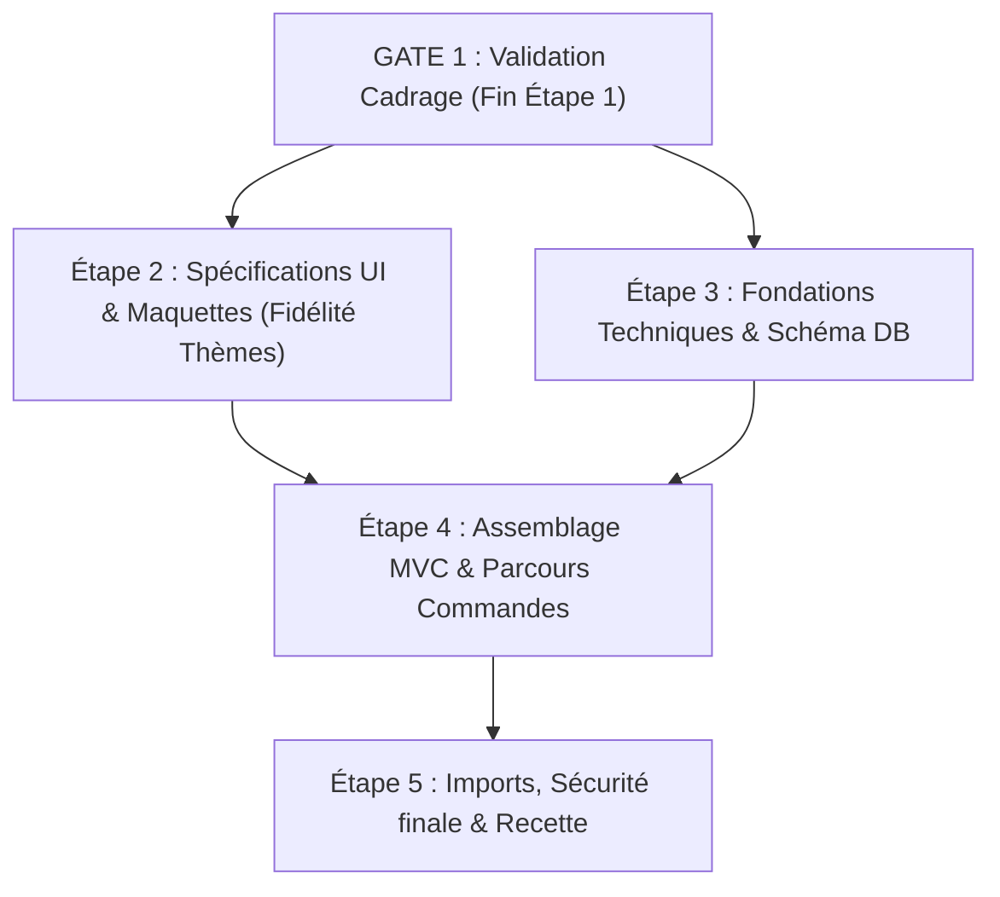

# ETAPE_1_DECISIONS_ET_BLOCAGES.md
# Décisions d'arbitrage et questions bloquantes — Marvens Shop MVP

**Date :** 05 novembre 2026  
**Étape :** Étape 1 — Cadrage, audit du dépôt et validation du périmètre  
**Agent :** Agent principal de réalisation technique (Google Antigravity)  
**Destinataire :** Responsable Produit / Porteur du projet

---

## 1. Tableau synthétique des arbitrages documentaires

Ce tableau formalise les contradictions relevées entre les documents sources, la décision appliquée en vertu de la hiérarchie des sources (`AGENTS.md`) et le statut de validation.

| ID | Sujet audité | Contradiction observée | Décision appliquée (Hiérarchie AGENTS.md) | Statut |
|---|---|---|---|---|
| **ARB-01** | **Nature de l'architecture : MVP Dédié vs SaaS** | Le fichier parent `resumé avec saas.docx` évoque un onboarding multi-boutiques, alors que `Marvens_Shop_Document_Complet_MVP.docx` impose formellement une instance dédiée par client. | **Instance individuelle par commerçant au MVP**. Aucun code multi-tenant ni `tenant_id` n'est implémenté. | **Confirmé (Sources)** |
| **ARB-02** | **Rôles utilisateurs au MVP** | `Paramètres.docx` liste 8 rôles détaillés (Gestionnaire stock, Comptable, Préparateur, etc.), alors que le Document Complet et le CDC indiquent qu'un seul compte commerçant suffit pour le MVP. | **Uniquement le rôle `merchant_admin`** au MVP. Le rôle `staff` reste une extension ultérieure conditionnelle. | **Confirmé (Sources)** |
| **ARB-03** | **Technologie de template : Tailwind vs Bootstrap 5** | Les maquettes de Stitch (`themes/*.zip`) intègrent Tailwind CDN, tandis que `ARCHITECTURE_TECHNIQUE_PROJET.md` et `AGENTS.md` imposent formellement Bootstrap 5 et vanilla CSS. | **Bootstrap 5 + CSS3 personnalisé**. Les styles et tokens de `DESIGN.md` sont traduits fidèlement en classes et variables CSS sans inclure Tailwind CDN. | **Confirmé (Architecture)** |
| **ARB-04** | **Paiement et confirmation WhatsApp** | Risque d'amalgame entre clic WhatsApp et confirmation de paiement. | **Déconnexion totale** : WhatsApp sert de canal d'échange. La commande reste enregistrée avec statut distinct modifiable manuellement dans le dashboard. | **Confirmé (Règle BIZ)** |
| **ARB-05** | **Gestion des arrondis et devises (FCFA)** | `Paramètres.docx` évoque EUR/USD/FCFA. Le marché cible prioritaire est le Cameroun/Afrique Centrale (XAF). | **Devise principale par défaut : FCFA (XAF)**, avec montants entiers (pas de centimes sur le FCFA). | **À confirmer** |

---

## 2. Questions bloquantes nécessitant une validation humaine

Pour aborder les Étapes 2 (UX/UI) et 3 (Fondations techniques) avec une totale sérénité, merci de vous prononcer sur les **3 questions priorisées** ci-dessous :

### Question 1 : Activation et profondeur du catalogue Meta au MVP
- **Contexte :** L'importation Meta Graph API nécessite une application Meta Developer vérifiée, des autorisations Business Manager et des jetons OAuth actifs.
- **Impact technique :** Si les clés API Meta ne sont pas disponibles lors de la recette du MVP, l'écran d'import Meta affichera un état « Configuration requise ». En parallèle, l'import CSV permettra d'importer immédiatement des catalogues complets.
- **Recommandation de l'agent :** **Valider l'import CSV comme fonctionnel par défaut au MVP**, et livrer le module Meta avec son adaptateur d'infrastructure prêt à recevoir les clés API dès leur obtention par le commerçant.
- **Décision attendue :** *(Validation du propriétaire : OUI / NON)*

### Question 2 : Format et calcul des frais de livraison
- **Contexte :** `Paramètres.docx` mentionne une livraison à domicile et retrait boutique, avec possibilité de tarification par ville ou quartier.
- **Impact technique :** Détermine la structure de la table de configuration `shipping_zones` et le calcul du montant total lors du checkout.
- **Recommandation de l'agent :** Retenir pour le MVP deux modes : **1. Retrait gratuit en boutique**, **2. Livraison à domicile avec tarif forfaitaire par quartier/zone configurable** (ex: Douala - Akwa : 1 000 FCFA, Bonapriso : 1 500 FCFA).
- **Décision attendue :** *(Validation du propriétaire : OUI / NON)*

### Question 3 : Prise en charge initiale des variantes de produits
- **Contexte :** Certains commerçants vendent des produits simples (accessoires, cosmétiques), d'autres du prêt-à-porter avec tailles et couleurs (`Theme fashion.zip`).
- **Impact technique :** Détermine si le schéma de base de données de l'Étape 3 intègre une table relationnelle `product_variants` (taille, couleur, stock/disponibilité propre) dès la première version.
- **Recommandation de l'agent :** **Intégrer le support des variantes simples (taille, couleur, surcoût éventuel)** dans le modèle de données dès l'Étape 3 pour coller parfaitement au thème par défaut Fashion.
- **Décision attendue :** *(Validation du propriétaire : OUI / NON)*

---

## 3. Dépendances et risques pour les Étapes 2 à 5

1. **Prérequis pour démarrer l'Étape 2 (Agent UX/UI) :**
   - Confirmation de la liste des écrans cibles (Boutique Fashion + Dashboard Swiss Commerce).
   - Validation que la conversion Tailwind CDN → Bootstrap 5 / CSS Variables est acceptée pour préserver la fidélité sans violer la stack.
2. **Prérequis pour démarrer l'Étape 3 (Agent Fondations) :**
   - Validation du modèle de données (produits, variantes, commandes, clients, paramètres).
   - Initialisation du dépôt Git local et configuration de l'arborescence MVC (`public/`, `app/`, `config/`, `database/migrations/`).
3. **Points de blocage levés :**
   - Aucune ambiguïté résiduelle sur le périmètre : le SaaS est formellement exclu du MVP.
   - Tous les thèmes sources sont disponibles et audités.
