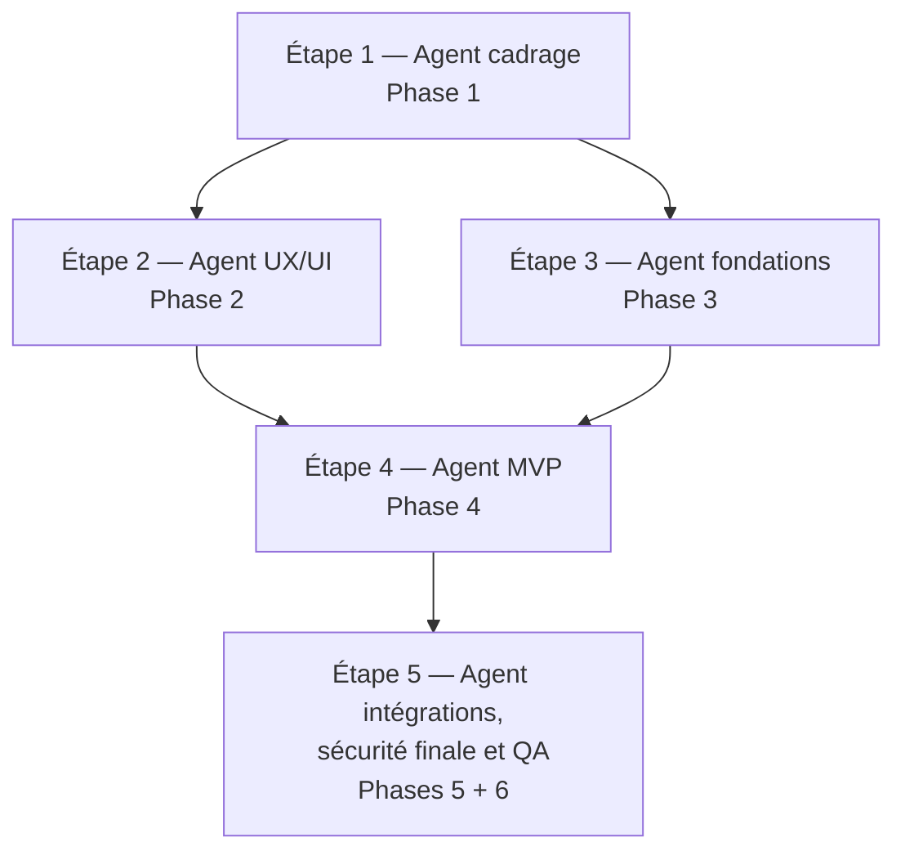

# PLAN_REALISATION_APPLICATION.md
## Marvens Shop — Plan de réalisation technique du MVP

**Version :** 1.0  
**Date :** 05 novembre 2026  
**Usage :** plan d'exécution pour agents IA (Codex / Google Antigravity)  
**Règle d'exécution :** une étape correspond à une mission principale confiée à un agent IA.  
**Périmètre :** développement du MVP installé individuellement chez chaque commerçant ; ce document ne demande pas de développer un SaaS.

---

## 1. Objectif et règles de travail

Ce plan transforme les documents Marvens Shop en missions ordonnées, limitées et vérifiables. Les agents doivent produire les livrables attendus, respecter les dépendances et éviter de relire l'ensemble du dossier à chaque mission.

### Références du projet

- `Marvens_Shop_Document_Complet_MVP.docx` : vision, périmètre MVP, mini-site, catalogue, panier, commandes, WhatsApp, import et modèle d'installation.
- `FONCTIONNALITÉS.docx` : fonctionnalités publiques, dashboard, thèmes Stitch, personnalisation visuelle et parcours.
- `Paramètres.docx` : rubriques du dashboard, identité boutique, apparence, livraison, rôles, notifications, intégrations, sécurité et analytics.
- `ARCHITECTURE_TECHNIQUE_PROJET.md` : architecture MVC, modules, routes, modèle de données, sécurité, stockage, déploiement et stratégie de tests.
- `MARVENS_CREATIVE_BRIEF_MARVENS_SHOP_20261104_151943.zip` : source de référence pour direction artistique, UX/UI, design system, intégration Stitch, accessibilité, standards frontend/PHP et QA.
- `themes/` dans l'espace de travail : thèmes Stitch à inventorier et utiliser comme choix de template. Leur présence, leurs noms, leurs fichiers et leur compatibilité doivent être vérifiés par l'agent ; ne pas inventer de thème si le dossier est absent ou incomplet.
- `AGENTS.md` : instructions applicables au dépôt et à ses sous-dossiers. Il doit être lu par chaque agent avant toute action.

### Contraintes non négociables

- PHP 8.3+ Vanilla MVC, MySQL 8, PDO, HTML5/CSS3, JavaScript Vanilla et Bootstrap 5.
- Hébergement cPanel mutualisé ; aucun Laravel, Node.js en production, Docker, microservices ou processus permanent.
- Une installation par commerçant pour le MVP ; SaaS, multi-tenant, inscription autonome et abonnement SaaS hors périmètre.
- La commande doit être enregistrée côté serveur avant l'ouverture de WhatsApp. L'ouverture de WhatsApp ne signifie pas que le message a été envoyé ou que la commande est confirmée.
- Pas de passerelle de paiement en ligne dans le MVP ; paiement et confirmation restent configurables/manuels selon décisions validées.
- Les thèmes ne doivent modifier que la présentation, jamais les données commerciales.
- Toute décision non explicitement confirmée doit être marquée **À valider** et soumise au responsable produit.
- Ne pas coder pendant les missions de cadrage et de conception. Ne pas élargir le périmètre sans validation.

### Phases obligatoires

Les six phases sont couvertes dans cinq étapes-agent. La phase 6 est intégrée à l'étape 5, sans supprimer ses contrôles.

| Phase | Étape-agent |
|---|---:|
| 1. Cadrage et validation | Étape 1 |
| 2. Conception UX/UI | Étape 2 |
| 3. Fondations techniques | Étape 3 |
| 4. Développement du MVP | Étape 4 |
| 5. Intégrations externes | Étape 5 |
| 6. Sécurité et tests | Étape 5, avec contrôles continus aux étapes 3 et 4 |

---

## 2. Ordre d'exécution et parallélisation



### Agents pouvant travailler en parallèle

- **Étapes 2 et 3 :** peuvent démarrer en parallèle après validation de l'étape 1, à condition que l'agent fondations n'implémente pas de décisions UI non validées. L'agent UX/UI produit les maquettes et spécifications ; l'agent fondations produit l'ossature technique et les contrats de modules.
- **Étape 4 :** doit attendre les livrables validés des étapes 2 et 3. Des sous-agents spécialisés peuvent ensuite traiter des modules indépendants, mais uniquement avec les contrats et interfaces approuvés par l'agent principal.
- **Étape 5 :** doit attendre que les parcours MVP et leurs interfaces soient stabilisés. Les tests de sécurité statiques et la préparation des environnements peuvent commencer plus tôt dans les étapes 3 et 4, mais la recette intégrée finale se fait après les intégrations.

### Règles de dépendance

1. L'étape 1 est un **gate** : aucune mission de conception ou de développement ne commence tant que le périmètre et les décisions bloquantes ne sont pas approuvés.
2. L'étape 2 et l'étape 3 peuvent avancer simultanément après le gate 1.
3. L'étape 4 dépend de la validation des maquettes UX/UI et des fondations techniques.
4. L'étape 5 dépend de l'intégration du MVP et des contrats d'intégration définis.
5. Chaque agent ne modifie que les fichiers qui lui sont attribués. Il doit signaler les conflits plutôt que modifier les livrables d'un autre agent.
6. Un agent ne doit pas relancer une étape déjà validée sans demande explicite ; il doit utiliser les livrables existants et ne lire que les sections nécessaires.

---

## Étape 1 — Cadrage et validation du périmètre

- **Phase :** 1. Cadrage et validation
- **Objectif :** consolider les exigences du MVP, arbitrer les ambiguïtés, établir le backlog priorisé et fournir un périmètre approuvé aux agents UX/UI et fondations.
- **Prérequis :**
  - Documents projet disponibles.
  - Responsable produit disponible pour arbitrer les questions **À valider**.
  - Lecture de `AGENTS.md` applicable.
- **Travaux :**
  1. Extraire et dédupliquer les exigences fonctionnelles des trois documents Word.
  2. Comparer les exigences à l'architecture technique existante ; identifier les contradictions et les fonctions non confirmées.
  3. Définir le périmètre Must / Should / Could / Out of scope pour la version installée MVP.
  4. Décrire les rôles confirmés et les permissions ; ne pas inventer les rôles secondaires.
  5. Définir les parcours critiques : visite → catalogue → fiche produit → panier → checkout → commande persistée → WhatsApp ; commerçant → dashboard → gestion catalogue/commandes/paramètres.
  6. Établir les critères d'acceptation fonctionnels et les décisions bloquantes.
  7. Inventorier `themes/` et le ZIP Creative Brief ; signaler les thèmes absents, incomplets ou non exécutables.
  8. Produire une matrice de traçabilité exigences → modules → écrans → tests.
- **Modules/pages :**
  - Mini-site public ; catalogue ; fiche produit ; panier ; checkout ; confirmation.
  - Dashboard ; produits ; catégories ; commandes ; paramètres ; apparence/thèmes ; import.
  - Authentification administrateur.
- **Maquettes concernées :**
  - Aucune maquette à créer à cette étape.
  - Inventaire des écrans à maquetter et des thèmes Stitch réellement disponibles.
- **Livrables :**
  - Périmètre MVP approuvé.
  - Backlog fonctionnel priorisé et IDs de exigences.
  - Liste des décisions **À valider**, avec responsable et impact.
  - Parcours utilisateurs et matrice exigences/modules/pages/tests.
  - Inventaire des fichiers Creative Brief et `themes/`.
  - Liste de risques et critères de sortie.
- **Tests :**
  - Revue de cohérence des exigences.
  - Vérification que chaque exigence MVP possède un module, un écran ou une justification d'absence et un critère testable.
  - Vérification que les éléments SaaS et paiements en ligne sont exclus.
- **Critères de validation :**
  - Le responsable produit approuve le périmètre et les décisions bloquantes.
  - Aucun besoin essentiel n'est laissé implicite.
  - Les éléments hors MVP sont explicitement listés.
  - Les thèmes Stitch disponibles sont inventoriés sans supposition.
  - Les étapes 2 et 3 disposent d'entrées stables.

### Contexte minimal à fournir à l'agent

- **Documents indispensables :**
  - `Marvens_Shop_Document_Complet_MVP.docx` : sections vision, objectifs, périmètre, utilisateurs, fonctionnalités, commande/WhatsApp, import et déploiement.
  - `FONCTIONNALITÉS.docx` : sections mini-site, thèmes, personnalisation, catalogue, panier/commande, dashboard et paramètres.
  - `Paramètres.docx` : structure du menu paramètres et détail des rubriques.
  - `ARCHITECTURE_TECHNIQUE_PROJET.md` : sections résumé architectural, décisions structurantes, modules et décisions à valider.
  - `AGENTS.md` applicable.
- **Sections indispensables :**
  - Les parties de chaque document qui définissent le périmètre, les rôles, les fonctionnalités, les paramètres et les éléments **À valider**.
  - Dans l'architecture : résumé, sources/contraintes, modules, routes, données, décisions à valider.
- **Modules concernés :** tous les modules MVP, uniquement pour établir leur périmètre.
- **Maquettes concernées :** aucune ; inventaire écran seulement.
- **Fichiers du code probablement concernés :** aucun fichier applicatif à modifier. Documents de cadrage uniquement.
- **Résultats attendus :** backlog, périmètre approuvé, matrice de traçabilité, décisions ouvertes, inventaire thèmes.
- **Tests à exécuter :** revue documentaire, cohérence fonctionnelle, traçabilité et checklist de sortie.

---

## Étape 2 — Conception UX/UI et validation des thèmes

- **Phase :** 2. Conception UX/UI
- **Objectif :** définir les parcours, écrans, états et règles de présentation ; transformer les thèmes Stitch présents en choix de templates validés et produire des maquettes exploitables par l'agent MVP.
- **Prérequis :**
  - Étape 1 validée.
  - Backlog et parcours approuvés.
  - Creative Brief et dossier `themes/` disponibles ou inventaire de leurs absences.
  - Lecture de `AGENTS.md` applicable.
- **Travaux :**
  1. Lire le framework Marvens Creative Brief et appliquer sa gouvernance : différenciation, direction artistique, UX, design system, accessibilité et validation.
  2. Inventorier chaque thème Stitch : nom, fichiers, preview, structure, composants, styles, responsive, dépendances et licence/conditions si disponibles.
  3. Vérifier que chaque thème est intégrable sans exécuter de code non contrôlé ni modifier les données métier.
  4. Définir navigation publique et dashboard, architecture de l'information, parcours et états (chargement, vide, erreur, succès, indisponible).
  5. Produire maquettes mobile-first pour les pages publiques et les écrans admin du MVP.
  6. Définir le contrat de thème : tokens, composants/slots, pages supportées, fallback, preview, activation, retour au thème précédent et reset.
  7. Définir personnalisation autorisée : logo, favicon, palette, typographie et éléments visuels ; séparer identité boutique et identité juridique.
  8. Vérifier la cohérence des formulaires, tableaux, états de commande, messages d'erreur, accessibilité et responsive.
  9. Documenter les composants réutilisables et le mapping maquette → module → données.
- **Modules/pages :**
  - Storefront : accueil, catalogue, catégorie, fiche produit, panier, checkout, confirmation.
  - Admin : login, dashboard, produits, catégories, liste/détail commande, paramètres, apparence/thèmes, import.
  - Composants communs : navigation, cards, prix, badges, formulaires, tables, alertes, empty/loading/error states.
- **Maquettes concernées :**
  - Toutes les maquettes du parcours public et dashboard MVP.
  - Une preview réelle par thème Stitch trouvé.
  - États responsive et états fonctionnels critiques.
  - Aucun thème de substitution inventé si le dossier `themes/` est absent.
- **Livrables :**
  - UX blueprint et parcours validés.
  - Maquettes desktop/mobile et états.
  - Inventaire des thèmes et rapport de compatibilité.
  - Design tokens et contrat d'intégration des thèmes.
  - Bibliothèque de composants/slots et mapping des écrans.
  - Checklist design/accessibilité/responsive.
  - Questions **À valider** restantes.
- **Tests :**
  - Revue UX des parcours critiques.
  - Audit responsive aux tailles 320, 360, 768, 1024 px et desktop.
  - Contraste, focus clavier, labels, messages d'erreur et navigation.
  - Vérification qu'un changement de thème ne modifie pas le contenu commercial.
- **Critères de validation :**
  - Chaque écran MVP possède une maquette, ses états et son module cible.
  - Les thèmes proposés correspondent aux fichiers Stitch effectivement présents et approuvés.
  - Le contrat de thème permet de changer la présentation sans toucher aux données.
  - Les maquettes sont approuvées par le responsable produit/design.
  - L'agent fondations peut avancer en parallèle sans inventer d'UI.

### Contexte minimal à fournir à l'agent

- **Documents indispensables :**
  - `AGENTS.md` applicable.
  - `FONCTIONNALITÉS.docx` : mini-site, catalogue, thèmes, personnalisation, panier/commande, dashboard et paramètres.
  - `Marvens_Shop_Document_Complet_MVP.docx` : vision, parcours client, commande et rôles.
  - ZIP Creative Brief : `PROJECT_CONTEXT.md`, `README_PROJECT.md`, `GENERATION_MANIFEST.md`, templates `MASTER_CREATIVE_BRIEF.md`, `UI_UX_BLUEPRINT.md`, `ART_DIRECTION_SELECTION.md`, `DESIGN_APPROVAL.md`, puis sections pertinentes UX/UI/design/QA.
  - Fichiers réellement présents dans `themes/` ; lire uniquement manifests, README, previews et fichiers d'entrée de chaque thème.
- **Sections indispensables du Creative Brief :**
  - Core : `FRAMEWORK_OVERVIEW.md`, `DESIGN_PHILOSOPHY.md`, `DESIGN_DIFFERENTIATION_ENGINE.md`, `CREATIVE_PROCESS.md`, `GOVERNANCE.md`.
  - Direction artistique : `ART_DIRECTION_GUIDELINES.md`, `DESIGN_REFERENCES.md`, `VISUAL_STYLE_LIBRARY.md`, `CREATIVE_EXPLORATION.md`, directions correspondant aux thèmes retenus.
  - UX : `INFORMATION_ARCHITECTURE.md`, `NAVIGATION_SYSTEM.md`, `USER_JOURNEYS.md`, `INTERACTION_DESIGN.md`, `UX_PRINCIPLES.md`, `ACCESSIBILITY.md`.
  - UI/design system : `UI_GUIDELINES.md`, `LAYOUT_SYSTEM.md`, `COMPONENT_DESIGN.md`, `FORMS_AND_TABLES.md`, `RESPONSIVE_DESIGN.md`, `DESIGN_TOKENS.md`, `CSS_ARCHITECTURE.md`, `COMPONENT_LIBRARY.md`.
  - QA design : `DESIGN_REVIEW_CHECKLIST.md`, `UX_AUDIT.md`, `RESPONSIVE_AUDIT.md`, `ACCESSIBILITY_AUDIT.md`, `DESIGN_SCORING.md`.
- **Modules concernés :** storefront, catalogue, panier/checkout, commandes, dashboard, paramètres, thèmes, import.
- **Maquettes concernées :** toutes les pages publiques/admin MVP et previews thèmes inventoriés.
- **Fichiers du code probablement concernés :** aucun code applicatif à modifier ; livrables design dans le dossier documentaire/maquettes convenu par le dépôt.
- **Résultats attendus :** maquettes validées, tokens, contrat thème, mapping UI/modules, rapport de compatibilité.
- **Tests à exécuter :** audit UX, responsive, accessibilité, cohérence theme switch, revue de design.

---

## Étape 3 — Fondations techniques et contrats de modules

- **Phase :** 3. Fondations techniques
- **Objectif :** établir une base PHP MVC, configuration, sécurité transversale, conventions, schéma initial et interfaces de modules, sans développer les fonctionnalités métier complètes.
- **Prérequis :**
  - Étape 1 validée.
  - Contrat fonctionnel stable.
  - Étape 2 peut être en cours ; les maquettes finales ne sont pas nécessaires pour le socle, mais les routes et contrats UI restent provisoires jusqu'à validation.
  - Lecture de `AGENTS.md` applicable.
- **Travaux :**
  1. Confirmer l'arborescence, le point d'entrée public, bootstrap, router et conventions MVC.
  2. Définir configuration par installation, secrets hors webroot, environnements et paramètres cPanel.
  3. Définir les migrations versionnées et le schéma MVP minimal : users, settings, categories, products, images, orders, order_items, historique statut, imports/audit selon périmètre validé.
  4. Définir repository PDO, transactions, validation, DTO, services, policies et erreurs.
  5. Mettre en place authentification/session, CSRF, permissions, headers sécurité, rate limiting et journalisation structurée.
  6. Définir service de stockage fichiers et règles de répertoire privé/public.
  7. Définir contrats internes pour storefront, catalogue, commandes, thème, import et intégrations.
  8. Préparer tests automatisés, données de test et commandes d'exécution compatibles PHP/cPanel.
  9. Produire un README technique de démarrage et conventions de contribution pour les agents.
  10. Ne pas créer de multi-tenant, SaaS, queue permanente ou API publique non requise.
- **Modules/pages :**
  - Infrastructure transversale : bootstrap, router, config, DB, session/auth, permissions, validation, logger, stockage.
  - Contrats des modules : catalogue, commandes, paramètres, thèmes, import.
- **Maquettes concernées :**
  - Aucun écran final à coder.
  - Préparer seulement les points d'intégration avec les maquettes de l'étape 2 : layout public/admin, slots thème, composants partagés.
- **Livrables :**
  - Squelette MVC validé.
  - Configuration et exemple sans secrets.
  - Migrations initiales et schéma documenté.
  - Contrats de services/repositories et routes.
  - Sécurité transversale de base.
  - README développeur, stratégie de tests et checklist cPanel.
  - Liste des décisions restant **À valider**.
- **Tests :**
  - Bootstrap et route de santé en environnement local.
  - Connexion PDO et migrations sur DB test.
  - Tests auth/session/CSRF/permissions.
  - Tests de configuration et accès interdit aux répertoires privés.
  - Lint PHP et vérification des conventions MVC.
- **Critères de validation :**
  - Application démarre avec la configuration de test.
  - Routes et contrats sont documentés.
  - Les migrations s'exécutent proprement et peuvent être rejouées de manière contrôlée.
  - Les secrets et fichiers privés ne sont pas exposés.
  - L'agent MVP dispose d'interfaces stables et d'une base testable.

### Contexte minimal à fournir à l'agent

- **Documents indispensables :**
  - `AGENTS.md` applicable.
  - `ARCHITECTURE_TECHNIQUE_PROJET.md` : sections principes, MVC, modules, arborescence, cycle requête, routes, base de données, auth, sécurité, stockage, logging, environnements et déploiement.
  - `Marvens_Shop_Document_Complet_MVP.docx` : modèle installation par commerçant et périmètre.
  - Creative Brief : standards techniques PHP MVC, sécurité, frontend, Bootstrap et performance.
  - Résultat de l'étape 1 : backlog, décisions approuvées, modules.
- **Sections indispensables du Creative Brief :**
  - `PHP_MVC_STANDARDS.md`, `SECURITY.md`, `FRONTEND_STANDARDS.md`, `BOOTSTRAP_GUIDELINES.md`, `PERFORMANCE.md`.
  - `ACCESSIBILITY_IMPLEMENTATION.md` seulement pour conventions structurelles applicables au socle.
- **Modules concernés :** infrastructure commune et contrats de tous les modules MVP.
- **Maquettes concernées :** contrats de layout et slots, sans implémentation visuelle complète.
- **Fichiers du code probablement concernés :**
  - `public/index.php`, `public/.htaccess`
  - `bootstrap/`, `config/`, `routes/`
  - `app/Http/`, `app/Domain/`, `app/Application/`, `app/Infrastructure/`, `app/Policies/`, `app/Validation/`, `app/Support/`
  - `database/migrations/`, `database/seeds/`
  - `tests/`, `.env.example`, `.gitignore`, `README.md`
  - `bin/` uniquement pour scripts CLI approuvés.
- **Résultats attendus :** squelette MVC, contrats, schéma initial, migrations, sécurité transversale, README.
- **Tests à exécuter :** lint, tests unitaires du socle, DB/migrations, auth/CSRF, permissions, contrôle webroot/stockage.

---

## Étape 4 — Développement du MVP fonctionnel

- **Phase :** 4. Développement du MVP
- **Objectif :** implémenter les parcours métier validés, du storefront à la gestion dashboard, avec données persistées, responsive et thème sélectionnable.
- **Prérequis :**
  - Étape 1 validée.
  - Étape 3 validée : MVC, DB, migrations, auth, services transversaux.
  - Étape 2 validée pour les écrans, états, composants et contrats thème.
  - Lecture de `AGENTS.md` applicable.
- **Travaux :**
  1. Implémenter le storefront : accueil, catalogue, catégories, recherche/filtre, pagination, fiche produit, pages informatives confirmées.
  2. Implémenter gestion catégories et produits : CRUD, publication, prix/promo, images, disponibilité, références et variantes seulement si confirmées.
  3. Implémenter panier : ajout, retrait, quantités, variantes, recalcul serveur et persistance de session.
  4. Implémenter checkout : validation coordonnées, zone/mode livraison et mode paiement configurés, notes, idempotence.
  5. Enregistrer commande et snapshot des lignes dans une transaction avant d'afficher la confirmation.
  6. Construire message WhatsApp prérempli et encodé ; prévoir fallback numéro/message copiable.
  7. Implémenter dashboard : KPIs validés, liste/détail commande, transitions de statut, historique, recherche/filtre.
  8. Implémenter paramètres de boutique : identité, contacts, devise/langue/timezone, livraison/retrait, méthodes de paiement disponibles manuellement.
  9. Implémenter bibliothèque de thèmes à partir des thèmes Stitch inventoriés : aperçu, activation, thème actif, retour précédent/reset et personnalisation autorisée.
  10. Garantir que le changement de thème conserve produits, catégories, commandes, clients, paramètres et fonctionnalités.
  11. Implémenter import/export CSV si inclus dans le périmètre approuvé ; préparer le module sans Meta live si l'accès Meta n'est pas encore validé.
  12. Ajouter états UX, messages, validation, accessibilité, responsive et logs.
- **Modules/pages :**
  - Public : accueil, catalogue, catégorie, produit, panier, checkout, confirmation, pages pratiques.
  - Admin : login, dashboard, produits, catégories, commandes, paramètres, thèmes.
  - Import CSV : uniquement si approuvé et compatible avec le MVP.
- **Maquettes concernées :**
  - Toutes les maquettes validées de l'étape 2.
  - États loading/empty/error/success.
  - Preview et activation de chaque thème Stitch accepté.
- **Livrables :**
  - MVP fonctionnel dans le dépôt.
  - Migrations et données de démonstration.
  - Parcours client et commerçant intégrés.
  - Catalogue de thèmes Stitch validés et sélection persistée.
  - Tests unitaires, intégration et fonctionnels de chaque module.
  - Rapport de couverture fonctionnelle et anomalies restantes.
- **Tests :**
  - Parcours complet catalogue → panier → checkout → commande persistée → WhatsApp.
  - Contrôle des prix et quantités côté serveur.
  - Double soumission checkout et token de confirmation.
  - CRUD produit/catégorie, publication et image.
  - Transitions commande et historique.
  - Thème switch : aucune perte de données ; tous les écrans restent fonctionnels.
  - Responsive/accessibilité sur les pages principales.
  - Import CSV avec données valides, invalides, doublons et fichier limite si inclus.
- **Critères de validation :**
  - Tous les critères d'acceptation de l'étape 1 sont passés ou explicitement reportés.
  - La commande est enregistrée avant la redirection WhatsApp.
  - Aucun état WhatsApp « envoyé » ou commande « confirmée » n'est déduit de l'ouverture du lien.
  - Les fonctions commerciales restent indépendantes du thème.
  - Les pages et actions admin sont protégées par permission serveur.
  - L'agent remet une liste précise des anomalies et décisions restantes.

### Contexte minimal à fournir à l'agent

- **Documents indispensables :**
  - `AGENTS.md` applicable.
  - Backlog et matrice de traçabilité de l'étape 1.
  - Maquettes, contrat thème, design tokens et composants validés de l'étape 2.
  - Contrats MVC, routes, DB, sécurité et README de l'étape 3.
  - `FONCTIONNALITÉS.docx` : uniquement les sections correspondant aux modules attribués.
  - `Paramètres.docx` : rubriques identité, apparence, livraison, rôles, notifications et intégrations selon backlog validé.
- **Sections indispensables du Creative Brief :**
  - `MODULE_ECOMMERCE.md` (et `MODULE_WEBSITE.md` uniquement pour les pages publiques).
  - `UI_GUIDELINES.md`, `COMPONENT_DESIGN.md`, `FORMS_AND_TABLES.md`, `LAYOUT_SYSTEM.md`, `RESPONSIVE_DESIGN.md`.
  - `DESIGN_TOKENS.md`, `CSS_ARCHITECTURE.md`, `COMPONENT_LIBRARY.md`, `DESIGN_SYSTEM_GOVERNANCE.md`.
  - `ACCESSIBILITY_IMPLEMENTATION.md`, `FRONTEND_STANDARDS.md`, `BOOTSTRAP_GUIDELINES.md`, `PHP_MVC_STANDARDS.md`.
  - Pour les thèmes : `STITCH_INTEGRATION_GUIDE.md`, manifests et fichiers des thèmes réellement présents.
- **Modules concernés :** modules MVP listés dans le backlog ; pas de SaaS ni paiement en ligne.
- **Maquettes concernées :** maquettes approuvées pour chaque module assigné, y compris états et responsive.
- **Fichiers du code probablement concernés :**
  - `app/Application/Catalog/`, `Checkout/`, `Orders/`, `Settings/`, `Dashboard/`, `Imports/` selon périmètre.
  - `app/Domain/Catalog/`, `Orders/`, `Shared/`.
  - `app/Http/Controllers/`, `app/Views/storefront/`, `app/Views/admin/`, layouts et composants.
  - `resources/themes/`, `resources/css/`, `resources/js/`, `public/assets/`.
  - `database/migrations/`, `database/seeds/`, `tests/`.
  - Ne pas toucher aux fichiers de configuration/secrets sans mandat.
- **Résultats attendus :** modules intégrés, migrations, views, assets, tests et rapport d'avancement.
- **Tests à exécuter :** tests unitaires/integration/functional par module, parcours E2E MVP, permissions, responsive, accessibilité, thèmes, import CSV approuvé.

---

## Étape 5 — Intégrations externes, sécurité finale et recette QA

- **Phase :** 5. Intégrations externes + 6. Sécurité et tests
- **Objectif :** connecter les services externes réellement approuvés, durcir l'application, réaliser la recette complète et préparer la livraison cPanel.
- **Prérequis :**
  - Étape 4 intégrée et stable.
  - Contrats d'intégration et accès de test disponibles.
  - Décisions sur Meta, CSV/XLSX, email, analytics, notifications et PWA confirmées.
  - Lecture de `AGENTS.md` applicable.
- **Travaux :**
  1. Vérifier la faisabilité Meta : app, permissions, OAuth, catalogue autorisé, version API, scopes et environnements de test. Ne pas supposer qu'un accès est accordé.
  2. Implémenter l'adaptateur Meta et le flux OAuth seulement si validés : state anti-CSRF, scopes minimaux, token protégé, import idempotent, erreurs et rapport.
  3. Finaliser CSV et XLSX uniquement si la bibliothèque PHP, les extensions cPanel et le volume sont validés ; CSV demeure la voie de repli.
  4. Implémenter email, analytics, notifications ou autres intégrations seulement si explicitement approuvés ; sinon documenter comme hors MVP.
  5. Réaliser revue sécurité : SQLi, XSS, CSRF, auth, session fixation, permissions/IDOR, brute force, upload, secrets, logs, checkout idempotent et accès fichiers.
  6. Tester les cas d'intégration : token expiré, refus permission, timeout, réponse malformée, import partiel, doublon et reprise.
  7. Effectuer recette fonctionnelle et responsive de bout en bout, incluant thèmes et parcours commande.
  8. Vérifier installation propre cPanel, HTTPS, permissions, migrations, cron CLI, logs, backup et restauration.
  9. Produire rapport QA, liste des anomalies, risques résiduels et décision Go/No-Go.
  10. Corriger les anomalies bloquantes ; ne pas ajouter de nouvelles fonctionnalités durant la recette.
- **Modules/pages :**
  - Import Meta/CSV/XLSX conditionnel.
  - Configuration des intégrations.
  - Authentification, sessions, permissions, upload, checkout, logs et audit.
  - Tous les parcours publics/admin pour la recette finale.
- **Maquettes concernées :**
  - Écrans import/connectivité, états d'erreur et de progression si intégration activée.
  - Écrans sécurité/configuration seulement s'ils sont dans le périmètre validé.
  - Toutes les maquettes MVP pour la recette responsive finale.
- **Livrables :**
  - Intégrations approuvées opérationnelles ou rapport de blocage externe.
  - Rapport de sécurité et tests.
  - Rapport de recette fonctionnelle et responsive.
  - Liste des anomalies P0/P1/P2 et état de correction.
  - Guide d'installation et de déploiement cPanel.
  - Procédure de sauvegarde/restauration testée.
  - Release candidate et décision Go/No-Go.
- **Tests :**
  - Meta OAuth et import sandbox, si activés.
  - CSV/XLSX : mapping, validation, doublons, erreurs, limite de taille et reprise.
  - Sécurité : SQL injection, XSS, CSRF, session fixation, brute force, IDOR, traversal, upload malveillant, exposition secrets.
  - API/routes : auth, permissions, validation, statuts, rate limit.
  - Parcours E2E public et admin.
  - Responsive et accessibilité.
  - PWA uniquement si son périmètre a été validé : installabilité, cache assets, pages dynamiques non mises en cache, update et fallback offline.
  - Cron CLI, verrouillage et idempotence.
  - Déploiement cPanel, backup et restauration.
- **Critères de validation :**
  - Toutes les intégrations activées ont des tests positifs et négatifs ; les intégrations non approuvées sont clairement désactivées et documentées.
  - Aucun défaut P0/P1 ouvert.
  - Aucun secret ou fichier privé exposé.
  - Les commandes, permissions, thèmes et données persistent correctement après déploiement.
  - Recette signée par le responsable produit.
  - Release candidate déployable sur une installation dédiée sans SaaS.

### Contexte minimal à fournir à l'agent

- **Documents indispensables :**
  - `AGENTS.md` applicable.
  - `ARCHITECTURE_TECHNIQUE_PROJET.md` : sections intégrations, sécurité, stockage, logging, cron, performance, configuration, cPanel, backup/restore et tests.
  - Backlog et critères d'acceptation approuvés de l'étape 1.
  - Rapport de l'étape 4 et tests déjà exécutés.
  - `Paramètres.docx` : uniquement les rubriques d'intégrations, notifications, sécurité et analytics approuvées.
  - Creative Brief : standards sécurité, performance, accessibilité et QA.
- **Sections indispensables du Creative Brief :**
  - `SECURITY.md`, `PERFORMANCE.md`, `ACCESSIBILITY_IMPLEMENTATION.md`.
  - `DESIGN_REVIEW_CHECKLIST.md`, `RESPONSIVE_AUDIT.md`, `ACCESSIBILITY_AUDIT.md`, `UX_AUDIT.md`, `DESIGN_SCORING.md`.
  - `STITCH_INTEGRATION_GUIDE.md` seulement pour vérifier les thèmes livrés.
- **Modules concernés :** imports, intégrations approuvées, auth/session, permissions, upload, commandes, logs, déploiement et tous les modules soumis à recette.
- **Maquettes concernées :** écrans intégrations/import et toutes les maquettes MVP pour recette finale.
- **Fichiers du code probablement concernés :**
  - `app/Infrastructure/Meta/`, `Files/`, `Logging/`, `Mail/` si activés.
  - `app/Application/Imports/`, `app/Http/Controllers/`, `app/Http/Middleware/`, `app/Policies/`.
  - `config/`, `routes/`, `bin/`, `database/migrations/`.
  - `tests/Integration/`, `tests/Functional/`, `tests/Security/`.
  - `docs/INSTALLATION_CPANEL.md`, `docs/API.md`, `README.md`.
- **Résultats attendus :** intégrations validées, tests sécurité/QA, release candidate, guide cPanel, rapport Go/No-Go.
- **Tests à exécuter :** tests d'intégration externes, suite sécurité, E2E, responsive/accessibilité, cron, déploiement, sauvegarde/restauration.

---

## 3. Répartition des agents et règles de parallélisation

| Agent / étape | Peut démarrer quand | Peut travailler en parallèle avec | Doit attendre |
|---|---|---|---|
| Agent 1 — Cadrage | Dès disponibilité des documents | Aucun autre agent de réalisation | Validation responsable produit |
| Agent 2 — UX/UI | Après validation étape 1 | Agent 3 — Fondations | Maquettes/contrat validés avant étape 4 |
| Agent 3 — Fondations | Après validation étape 1 | Agent 2 — UX/UI | Contrats et socle validés avant étape 4 |
| Agent 4 — MVP | Après étapes 2 et 3 validées | Sous-agents de modules indépendants si contrats fixés | Interfaces, DB et maquettes approuvées |
| Agent 5 — Intégrations + sécurité + QA | Après MVP stable | Revue documentaire/plan de test peut être préparée plus tôt | Intégration MVP et accès sandbox |

### Sous-agents autorisés pendant l'étape 4

L'agent principal de l'étape 4 peut déléguer les modules ci-dessous **en parallèle**, à condition que les contrats de l'étape 3 soient figés et que les maquettes de l'étape 2 soient validées :

- **Agent 4A — Storefront et thèmes :** pages publiques, composants thème, responsive.
- **Agent 4B — Catalogue :** catégories, produits, images et publication.
- **Agent 4C — Panier/checkout/commande :** règles serveur, transaction, confirmation et WhatsApp.
- **Agent 4D — Dashboard/paramètres :** commandes, statut, paramètres boutique et apparence.
- **Agent 4E — Import CSV :** seulement si le périmètre et le contrat d'import sont validés.

L'agent principal doit intégrer les branches, résoudre les conflits, lancer les tests transversaux et fournir une seule release cohérente. Les sous-agents ne doivent pas modifier simultanément les mêmes fichiers partagés (router, bootstrap, migrations communes, layouts ou tokens) sans attribution explicite.

---

## 4. Règles communes à tous les agents IA

Chaque agent doit :

1. Lire le `AGENTS.md` applicable à la racine et aux dossiers touchés.
2. Lire uniquement les documents/sections listés dans son **Contexte minimal** et les fichiers directement concernés.
3. Lire les dépendances immédiates du module : interfaces, services appelés, repositories, composants partagés, migrations et tests.
4. Vérifier l'état du dépôt et les changements existants avant de modifier un fichier.
5. Ne pas écraser le travail d'un autre agent ; signaler les conflits.
6. Respecter les conventions PHP MVC, PDO, Bootstrap 5 et JS Vanilla.
7. Ne pas ajouter de framework, dépendance, service externe ou fonctionnalité hors périmètre sans approbation.
8. Ne jamais inventer de fichiers Stitch, maquettes, accès Meta, secrets, données ou décisions produit.
9. Marquer les inconnues **À valider** et indiquer si elles bloquent le travail.
10. Exécuter les tests correspondant à la mission et fournir les commandes, résultats et anomalies.
11. Mettre à jour uniquement les documents de suivi attribués à l'étape.
12. Livrer un résumé compact : fichiers créés/modifiés, exigences couvertes, tests, anomalies, décisions ouvertes, prochaine dépendance.

### Format de rapport obligatoire de chaque agent

```markdown
## Rapport — Étape N

- Statut : terminé / terminé avec réserves / bloqué
- Exigences couvertes :
- Fichiers créés :
- Fichiers modifiés :
- Tests exécutés :
- Résultats :
- Anomalies :
- Décisions À valider :
- Dépendances pour l'agent suivant :
- Recommandation : poursuivre / corriger / bloquer
```

---

## 5. Gate de livraison du MVP

Le MVP est prêt à être installé chez un premier commerçant lorsque :

- le périmètre approuvé est couvert ou les reports sont acceptés ;
- les parcours catalogue → panier → commande → WhatsApp et dashboard sont vérifiés ;
- les commandes et lignes sont persistées correctement ;
- l'ouverture WhatsApp n'est pas interprétée comme un envoi confirmé ;
- le choix des thèmes Stitch et les personnalisations approuvées fonctionnent sans perte de données ;
- les paramètres essentiels de boutique et de livraison sont configurables ;
- les accès admin, CSRF, validation, upload et secrets sont sécurisés ;
- la suite de tests fonctionnels, sécurité, responsive et accessibilité est passée ;
- les intégrations externes non approuvées sont désactivées et documentées ;
- l'installation cPanel, les migrations, les sauvegardes et la restauration ont été vérifiées ;
- aucun défaut P0/P1 ne reste ouvert ;
- le responsable produit donne le Go final.

**Rappel :** ce plan est un ordre de réalisation. Il ne vaut pas autorisation d'ajouter les fonctions SaaS, paiements en ligne, notifications, analytics externes, rôles avancés ou PWA offline au-delà du périmètre confirmé. Toute extension doit être arbitrée et tracée avant développement.
